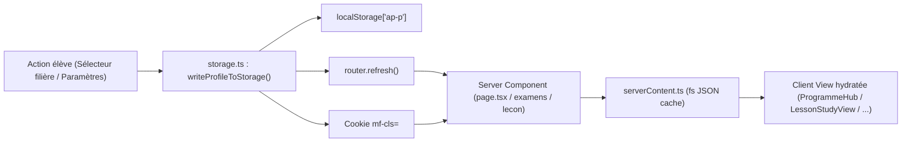
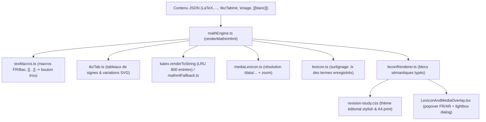
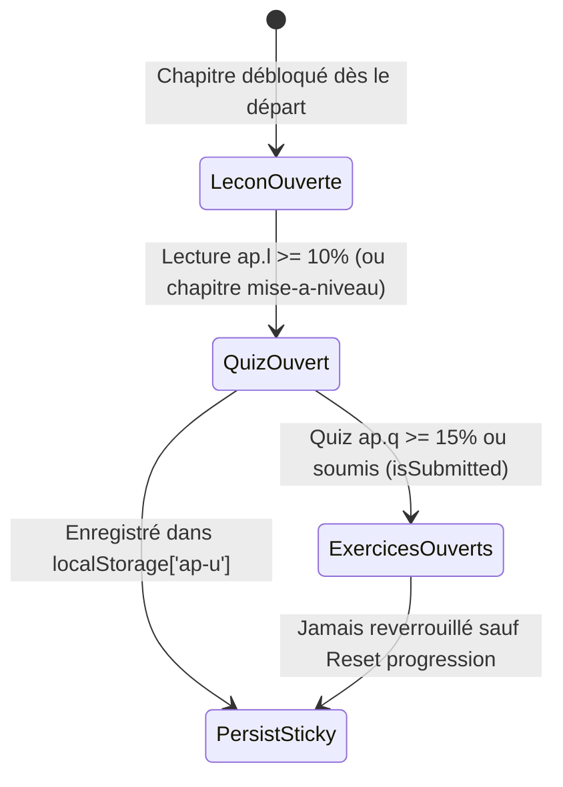

# Livret d’Architecture — Apprendre Next.js (`apps/apprendre-next`)

> **Règle d’or (Document vivant)** : Ce livret décrit fidèlement l’architecture, les circuits de données, les dépendances et les mécanismes de l’application **Apprendre** (Next.js 15 App Router TypeScript). **Toute modification structurelle** (nouvelle route, module métier, API, règle de déblocage ou dépendance) **doit mettre à jour ce livret et passer `npm run verify:arch` avant commit.**

---

## 1. Application autonome

Le dossier `apprendre-next` est la racine du dépôt Mathix publié. Les cours, quiz et illustrations sont versionnés sous `public/data/`. Les images sources des icônes se trouvent dans `public/icons/`. Le build prépare le service worker, le manifeste et les deux icônes d’installation avec [sync-assets.mjs](scripts/sync-assets.mjs).

Les API utilisent les modules locaux [googleAuth.ts](src/server/cloud/googleAuth.ts), [firestoreRest.ts](src/server/cloud/firestoreRest.ts) et [appStateMerge.ts](src/server/cloud/appStateMerge.ts). Les seuils et le calcul de progression utilisés par les vues se trouvent dans [unlocks.ts](src/lib/unlocks.ts). Le projet Math-Plus parent sert de référence historique aux règles décrites en section 10.

---

## 2. Arborescence & Séparation en Couches Strictes

La séparation garantit qu’aucun module pur TypeScript ne manipule le DOM ou `window`, tandis que seuls les composants React gèrent l’état interactif et l’accessibilité.

```text
apps/apprendre-next/
├── ARCHITECTURE_LIVRET.md          <- Ce livret d'architecture (vérifié automatiquement)
├── eslint.config.mjs               <- Configuration ESLint 9 (Next Core Web Vitals + TS strict)
├── next.config.ts                  <- Config Next.js 15 (images, en-têtes, métadonnées et tracing)
├── scripts/
│   ├── sync-assets.mjs             <- Génération des icônes PWA, du manifeste et du SW
│   └── verify-architecture.mjs     <- Contrôle de cohérence Routes/Modules <-> Livret
└── src/
    ├── app/                        <- Couche 1 : Routes App Router (Server Components & API)
    ├── components/                 <- Couche 2 : Composants UI React 19 ('use client')
    ├── lib/                        <- Couche 3 : Cœur métier TypeScript pur (zéro IIFE/vendor)
    │   ├── math/                   <- KaTeX, macros, tkz-tab, lexique FR/AR, médias
    │   ├── lesson/                 <- Moteur blocs de révision + recherche plein texte
    │   ├── quiz/                   <- Normalisation & évaluation QCM/V-F/Ordre/Erreur/Saisie
    │   ├── exercise/               <- Parseur 3 niveaux + feuille d'examen A4
    │   └── content/                <- Lecture serveur JSON mémoïsée (React cache)
    └── styles/                     <- Couche 4 : Feuilles CSS sémantiques modulaires (Light+Dark)
```

---

## 3. Circuits & Mécanismes Fondamentaux

### Circuit A — Hydratation SSR sans Flash & Routage App Router (`mf-cls` ↔ `localStorage`)

Pour combiner rendu serveur instantané (**First Byte** adapté à la filière de l’élève) et fonctionnement hors-ligne, la classe active est synchronisée entre `localStorage['ap-p']` et le cookie `mf-cls`.



**Routes App Router natives enregistrées :**
- `src/app/page.tsx` (`/`) : Hub **Programme** (bannière ouverte sans cadre, onglets segmentés, chapitres non encadrés directement sur la page cahier, cadenas).
- `src/app/examens/page.tsx` (`/examens`) : Bibliothèque **Examens Nationaux** filtrable par session et année.
- `src/app/problemes/page.tsx` (`/problemes`) : Bibliothèque **Problèmes de synthèse** filtrable par thème.
- `src/app/prepa/page.tsx` (`/prepa`) : Hub **Prépa Concours** (ENSA, ENSAM, Médecine : quiz et annales).
- `src/app/lecon/[chapterId]/page.tsx` (`/lecon/[chapterId]`) : Fiche de révision (support `?sheet=` multi-fiches).
- `src/app/probleme/[id]/page.tsx` (`/probleme/[id]`) : Lecture guidée d’un problème de synthèse.
- `src/app/quiz/[chapterId]/page.tsx` (`/quiz/[chapterId]`) : Lanceur de quiz du chapitre (avec garde-fou `10 %`).
- `src/app/concours/[schoolId]/page.tsx` (`/concours/[schoolId]`) : Entraînement et annales chronométrées par école.
- `src/app/exercices/[chapterId]/page.tsx` (`/exercices/[chapterId]`) : Exercices guidés + mode `Feuille d'examen` (avec garde-fou `15 %`).
- `src/app/examen/[examId]/page.tsx` (`/examen/[examId]`) : Sujet d’examen national complet imprimable en A4.
- `src/app/api/health/route.ts`, `src/app/api/auth/route.ts`, `src/app/api/sync/route.ts` : Endpoints App Router Node.js.

---

### Circuit B — Chaîne Mathématiques, `tkz-tab`, Lexique FR/AR & Révision Stylish (`#les`)

Tout contenu texte/LaTeX passe par un pipeline déterministe (identique en SSR Node et côté client, avec IDs de marqueurs SVG déterministes FNV-1a).



**Typologie visuelle dans `revision-study.css` & `leconRenderer.ts` :**
- **Sections** : index doré `.ltr` (`A.`, `B.`), filet dégradé, titre supportant KaTeX, sommaire `#toc` avec recherche plein texte (`leconSearch.ts`) et ScrollSpy.
- **Introduction (`renderIntroHtml`)** : scène éditoriale d’ouverture `.intro.intro-editorial` (`.lede` avec `.intro-standfirst`, prose principale avec surlignages inline `.mf-objectif` / `.mf-defi`, `.intro-key-idea` éventuelle) + colonne latérale intelligente `.note-savant` (extraction de la phrase `\savant{...}` et portrait zoomable ou monogramme `.note-seal`), `.note-guide` (fil conducteur) ou `.note-context` ; les sections mixtes commençant par `intro` + exercices conservent la suite en section `A.` (`Mise en route`), et tout bloc `intro` / `savant` isolé dans une section reçoit une carte dédiée `.blk-intro` / `.blk[data-t="savant"]`.
- **Blocs de structure** :
  - `.blk-core` : `definition` (émeraude) et `theorem` / `property` / `proposition` / `corollary` / `lemma` (indigo royal) avec badge `.bt` et carte intérieure blanche `.bx`.
  - `.blk-method` : `method` / `technique` / `strategy` en **ambre chaleureux**, bordure `4px`, sans badge redondant si un titre `.q` est présent.
  - `.blk[data-t="application"]` & `example` : zone `.math-question` mise en valeur, correction dépliable `.sol`.
  - `.blk[data-t="rappel"]` / `summary` / `cela_permet_de` : carte arrondie avec pillule flottante supérieure.
  - `.blk[data-t="warning"]` : bannière légère en ligne `.bh-warn` avec pastille `!`.
  - `.blk.blk-bare` : texte de cours fluide sans cadre.

---

### Circuit C — Progression, Règles de Cadenas (`10 %` → `15 %`) & Garde-fou Direct

Le module pur [unlocks.ts](src/lib/unlocks.ts) arbitre l’accès sur le tableau de bord **et** protège les routes directes (`/quiz/[chapterId]` et `/exercices/[chapterId]`) :



- Aucun compteur **XP**, **points** ou **série/streak** n’existe dans le modèle (`types.ts`, `storage.ts`).
- La barre latérale ([SidebarRail.tsx](src/components/SidebarRail.tsx)) place en haut **Orientation** puis **Paramètres** juste en dessous, et en bas **Aide** (sans bouton Accueil ni section Messages) ; la modale Paramètres (`#set`) utilise un gabarit structuré par cartes avec interrupteurs et bouton de fermeture `×`.

---

### Circuit D — Orientation 5 Classes & Synchronisation Cloud CRDT / Hors-ligne

1. **Orientation officielle complète** ([orientationData.ts](src/lib/orientationData.ts), [orientation.ts](src/lib/orientation.ts), [OrientationModal.tsx](src/components/OrientationModal.tsx)) :
   - Couvre les 5 filières (`tronc-commun-sc`, `1ere-bac-sc-ex`, `1ere-bac-sc-math`, `2eme-bac-sc-ex`, `2eme-bac-sc-math`) avec onglets par domaine (`Algèbre`, `Analyse`, `Géométrie`, `Probabilités`, `Statistiques`) et accordéons `Contenus` + `Capacités attendues` rendus en KaTeX.
2. **Offline-first & Cloud CRDT** ([offlineDb.ts](src/lib/offlineDb.ts), [cloudSync.ts](src/lib/cloudSync.ts), [CloudAccountBox.tsx](src/components/CloudAccountBox.tsx), [api/auth/route.ts](src/app/api/auth/route.ts), [api/sync/route.ts](src/app/api/sync/route.ts)) :
   - Toute mutation hors-ligne (ou échec réseau) est mise en file IndexedDB (`mathflow_offline_db` / `sync_outbox`) puis purgée automatiquement au retour `online`.
   - Fusion CRDT monotone sans perte (`null < -1 < 0 < 1` pour les quiz, `null < 0 < 1 < 2` pour les exercices, `max` pour les pourcentages de leçon, timestamp pour le profil).
   - Endpoints compatibles Redis Upstash (L1) + Firestore REST (L2) + DLQ (`cloud:sync:dlq`), avec repli gracieux en mode local si les variables d’environnement cloud ne sont pas définies.

---

### Circuit E — Moteur Exercices v2, Cache LRU & Feuille d’Examen (`#exo`)

Le moteur d’exercices (`exerciseParser.ts`, `exerciseRenderer.ts`, `ExerciseRunnerView.tsx` et `views.css`) fonctionne en double vue **Pas à pas** / **Feuille d’examen A4** :
- **Parseur v2 (`toText`, `romanize` 1..3999, `sumBareme`)** : normalise chaînes, nombres et tableaux de paragraphes, évite qu’un `content: ""` masque `statement` / `text`, conserve les sous-questions parentes dotées d’un barème/indice/corrigé, et calcule le barème total par repli sur le niveau parent.
- **Rendu mémoïsé (LRU 600 entrées) & stabilité des index** : `exercices/[chapterId]/page.tsx` et `renderUnavailableExerciseHtml()` conservent les emplacements d’exercices même en cas d’échec réseau/format (`Recharger` ciblé `[data-a="retry"]`) afin de ne jamais décaler les notes stockées dans `state.e`.
- **Ergonomie & accessibilité** : chronomètre monotone (`performance.now()`, pause automatique hors onglet actif), temps mesuré **par exercice** lors de la validation, navigation clavier `←` / `→`, retour en haut de page avec gestion du focus, pastilles `role="group"` + `aria-current="true"` et badges de statut colorés (`À revoir`, `Presque`, `Maîtrisé`).

---

### Circuit F — Moteur Quiz v2, Tolérance Symbolique & A11y (`#quiz`)

Le moteur de quiz (`quizEngine.ts`, `QuizRunnerView.tsx` et `views.css`) unifie les types `mcq`, `boolean`, `input`, `order` et `error` :
- **Normalisation robuste (`resolveCorrectIndex`, `toText`)** : résout les indices corrects sans faux positif `-1 !== -1` (drapeaux d’options > index numérique/`correctIndex` string > `id` > lettre `A..F` > texte exact), accepte les alias booléens `v`/`oui`/`1` et signale `keyMissing` si aucune clé explicite n’existe.
- **Évaluation mathématique tolérante (`canonAnswer`, `sameAnswer`, `isAnswerable`)** : compare les réponses saisies avec normalisation NFC, virgule décimale (`0,5`), fractions `\frac{1}{2}` / `1/2`, racines `\sqrt`, égalités (`x = 0.5`) et tolérance flottante `1e-9` ; empêche de noter faux une validation à vide via `notice` (`role="alert"`) tout en distinguant les questions passées via `Passer`.
- **Feedback comparatif & accessibilité** : cartes options `.opt.is-selected` / `[aria-pressed="true"]`, retour détaillé `Attendu` vs `Votre choix` dans `#quiz-feedback` (`focus({ preventScroll: true })`), barre `progressbar` / minuteur `timer` et raccourcis clavier (`A..F`, `1..6`, `V/F`, `←`, `→`, `Entrée`).

---

### Circuit G — Persistance Fine & Reprise Intelligente d’Étude (`src/lib/resumeStore.ts`)

Sans altérer le format CRDT `ap` (`StudentState` dans `src/lib/storage.ts`) ni les verrous `ap-u` (`src/lib/unlocks.ts`), le module [resumeStore.ts](src/lib/resumeStore.ts) (`localStorage['ap-resume']`, borné LRU 120 entrées par type et purgé lors de `resetProgress()`) conserve l’état exact de reprise :
- **Leçons & Problèmes (`LessonStudyView.tsx`)** : mémorise la dernière fiche active (`lessonActiveSheet`), la position réelle de lecture (montée et descente, indépendamment de la maîtrise monotone `state.l`), la section visible et les trous `.blank` révélés ; attend `hydrated === true` avant restauration pour éviter toute écriture à `0 %`.
- **Quiz & Concours (`QuizRunnerView.tsx`)** : restaure la série active, l’index courant, les réponses/brouillons/passages, le décompte restant par question (`remainingByIdx`) et le mode synthèse ou révision des erreurs (avec repli automatique sur la 1re question non répondue si seule la progression cloud `state.q` est présente ; clé scopée `${classId}:${chapterId}:${serieId}` en multi-séries).
- **Exercices & Examens (`ExerciseRunnerView.tsx`)** : restaure l’exercice actif, le mode (`pas` / `examen`), les indices ouverts, les corrigés `<details class="sol">` dépliés, les auto-évaluations révélées et le temps cumulé par exercice (`spent`).
- **Hub Programme & Bibliothèques (`ProgrammeHub.tsx`, `LibraryHub.tsx`)** : déplie le dernier chapitre actif ou en cours après hydratation, dirige directement vers la bonne fiche/série, affiche l’étape exacte (« Question X / Y », « Exercice X / Y », section) et signale le `.is-last-step` (`Dernier arrêt`) sans encadré en haut.

---

## 4. Graphe des Dépendances Internes (Règles d’Import)

| Couche | Peut importer | Ne doit JAMAIS importer |
| :--- | :--- | :--- |
| `src/lib/math/*` | `katex`, autres modules `math/*` | `react`, `next/*`, `document`, `window` |
| `src/lib/lesson/*`, `quiz/*`, `exercise/*` | `src/lib/math/*`, `src/lib/types.ts` | `react`, `src/components/*`, DOM |
| `src/lib/unlocks.ts`, `storage.ts`, `resumeStore.ts`, `cloudSync.ts` | `src/lib/types.ts`, `offlineDb.ts` | `src/lib/content/serverContent.ts` |
| `src/lib/content/serverContent.ts` | `node:fs/promises`, `node:path`, `react` (`cache`) | Modules clients `'use client'` |
| `src/components/*` | `AppProvider`, `lib/*`, `next/*`, `lucide-react` | `serverContent.ts` |
| `src/app/**/page.tsx` | `serverContent.ts`, `mathEngine.ts`, `components/*` | Règles métier dupliquées |

---

## 5. Protocole de Mise à Jour (À Appliquer à Chaque Changement)

Avant de considérer une tâche terminée sur `apps/apprendre-next` :
1. **Mettre à jour ce livret** (`ARCHITECTURE_LIVRET.md`) si une route (`src/app/**`), une API (`/api/**`), un module (`src/lib/**`) ou un mécanisme est ajouté, renommé ou supprimé.
2. **Exécuter la suite complète** :
   ```bash
   npm ci
   npm run verify
   ```
   (`verify` enchaîne `verify:arch`, `typecheck`, `lint`, les tests PWA/CSP et `build`.)

---

## 6. PWA — Contrat réel et cycle des versions

La source canonique du service worker est **`scripts/pwa-worker.js`**. `scripts/sync-assets.mjs` génère `public/sw-apprendre.js`, le manifeste et deux icônes PNG de **192 × 192** et **512 × 512** depuis l’illustration existante (dépendance directe `sharp`). Les fichiers générés ne se modifient pas à la main. Le hash SHA-256 des sources applicatives, du worker, des données, des icônes et de la configuration distingue les caches de chaque version.

| Stockage PWA | Limite | Stratégie |
| :--- | ---: | :--- |
| Ressources locales | 256 entrées | Cache en priorité pour les chunks Next.js, CSS, polices locales et images |
| Données JSON | 120 entrées | Réseau en priorité, copie locale en secours |
| Documents HTML | 60 entrées | Réseau en priorité ; secours uniquement pour l’URL réellement enregistrée |
| Métadonnées | Filière active | Invalidation des documents lors de `SET_CLASS` |

- Seuls les caches préfixés `mathflow-apprendre-next-` sont nettoyés ; les caches Workbox du portail et ceux de la maquette sont préservés.
- Les API, requêtes RSC, actions serveur et origines externes restent **hors cache**. Le worker prolonge les écritures avec `event.waitUntil()` ; les réponses d’une ancienne filière ne repeuplent pas le cache après invalidation.
- `AppProvider.tsx` réchauffe le document et les ressources d’une page visitée après prise de contrôle du worker. Hors connexion, les liens internes passent en navigation document, car les réponses RSC ne sont pas persistées.
- Une URL inconnue hors ligne reçoit un document **503 explicite**, avec les liens déjà enregistrés. Une leçon ne reçoit plus silencieusement le HTML de l’accueil sous sa propre URL.
- Une nouvelle version attend normalement la fermeture des anciens clients avant activation, afin de préserver leurs chunks.
- **Portée exacte** : pages déjà consultées/préchauffées, avec leurs ressources locales enregistrées. Le programme entier, les Google Fonts et les images distantes ne sont pas téléchargés automatiquement. Une installation neuve nécessite une connexion initiale ; le mode avion doit être préparé en ouvrant les fiches souhaitées.
- Régressions autonomes : `node --test tests/pwa-worker.test.mjs` (sans navigateur ni dépendance de test ajoutée).

## 7. Audit et retouches du 16 novembre 2026

### 7.1 Compilation, contrôles et performances

Le build initial échouait sur les imports ESM `.js` du backend TypeScript partagé. Les imports internes de `firestoreRest.ts` vers `appStateMerge.ts` et `googleAuth.ts` sont désormais sans extension, afin que Turbopack et Webpack résolvent les vraies sources TypeScript. Le contournement temporaire `experimental.extensionAlias` a été retiré après correction des imports : il n’était pas pris en compte par Turbopack. Le développement standard utilise Turbopack et les API ont été contrôlées dans ce mode. L’option expérimentale `viewTransition`, sans consommateur dans les sources, a également été retirée. `NEXT_DIST_DIR=.next-audit` permet un audit de production isolé d’un serveur de développement utilisant `.next` ; les sorties d’audit et caches de compilation sont exclus de Git.

La commande `lint` utilise directement ESLint avec `--max-warnings=0`, à la place de `next lint` déprécié. La modale Orientation se charge à sa première ouverture ; l’interface d’aide décrit la disponibilité hors ligne réelle. La lecture de reprise de la bibliothèque n’utilise plus une dépendance artificielle dans `useMemo`. Une frontière `Suspense` sépare le contenu des routes de la navigation commune, notamment pour les longues leçons dont le document dépasse 512 Ko.

La CSP autorise `unsafe-eval` et les connexions WebSocket **uniquement lorsque `NODE_ENV=development`**, pour React Refresh/Webpack et HMR. En production, `unsafe-eval` et ces autorisations WebSocket génériques ne sont pas émis. Cela évite une application vide en développement tout en gardant la politique de production.

Au démarrage en développement, `AppProvider.tsx` désinscrit uniquement un éventuel ancien worker Next `/sw-apprendre.js` de la même origine, puis recharge une fois le document s’il était contrôlé. Les workers du portail/maquette et la progression en localStorage/IndexedDB sont préservés. Cela évite qu’une ancienne installation PWA fournisse des chunks périmés au serveur de développement. Le suivi de lecture capture aussi un défilement intervenu avant la fin de l’hydratation, après restauration de la position.

Le module pur `src/lib/lesson/lessonStudyRenderer.ts` calcule côté serveur le HTML mathématique, le sommaire et l’index de recherche des leçons/problèmes. `LessonStudyView.tsx` reçoit ce résultat sérialisable, sans refaire le pipeline KaTeX à l’hydratation ni recevoir la fiche brute. Les interactions, positions de lecture et recherches restent côté client. Les boutons à trou ont un nom accessible sans dévoiler la réponse. `htmlLimitedBots: /.*/` conserve les métadonnées statiques dans `<head>`, y compris lorsque le contenu est diffusé via `Suspense`.

`src/middleware.ts` transmet le chemin de page au layout via un en-tête de requête interne réécrit. Le module pur `src/lib/routeView.ts` sélectionne dès le SSR la bonne valeur `body[data-v]` : une leçon n’est plus d’abord peinte avec les dimensions du hub. `RouteViewSync.tsx` synchronise les navigations côté client dans `useLayoutEffect`, avant peinture. Ce circuit corrige une cause de décalages de mise en page lors de l’hydratation.

**Première mesure valide** : Lighthouse 13.6.0, Edge/Chromium 157 sans interface, scénario mobile simulé par défaut, accueil `/`, build de production local isolé sur le port 3111. Résultat ponctuel : performance **95/100**, accessibilité **100/100**, bonnes pratiques **100/100**, SEO **100/100** ; FCP et LCP **1,7 s**, TBT **230 ms**, CLS **0**, Speed Index **2,0 s**, transfert **461 Kio**. Le build annonce environ **233 Ko de JavaScript au premier chargement** de l’accueil et **242 Ko** pour une leçon. Les mesures issues du serveur de développement ont été écartées.

**Après les retouches** : le bundle initial annoncé par Next passe à **221 Ko pour l’accueil**, **223 Ko pour une leçon** et **103 Ko partagés**. Le dernier accueil mesuré avec une trace Lighthouse exploitable donne **93/100**, LCP **1,6 s**, TBT **300 ms**, CLS **0** ; les trois autres catégories donnent 100/100. La variation du score est compatible avec une mesure ponctuelle ; elle n’est pas présentée comme un gain garanti. Une longue leçon avait donné 50/100 avant les corrections DOM/layout. Les derniers passages Lighthouse sur cette leçon ont échoué dans l’outil (`NO_NAVSTART`) : aucun score de performance final n’en est déduit. Un relevé direct des API Performance du navigateur, sous réseau et CPU limités, complète le diagnostic ; il ne constitue pas un score Lighthouse.

Dernier relevé direct sur `/lecon/mise-a-niveau` : Edge, écran 390 × 844, CPU ralenti ×4, réseau 1,6 Mbit/s et latence 150 ms : FCP **812 ms**, LCP **6 844 ms**, CLS **0,002**, tâche maximale **681 ms**, blocage total observé sur la fenêtre mesurée **986 ms**. Le document contient environ **22 470 nœuds**. Le décalage visuel a nettement diminué après le layout SSR ; les longues fiches complètes restent coûteuses sur mobile simulé. Leur chargement progressif et la réduction du DOM mathématique constituent une optimisation ultérieure : la fluidité n’est pas certifiée à 100 % sur tous les appareils/réseaux.

Ces nombres sont des mesures de laboratoire locales, sans valeur de garantie sur téléphone réel ou réseau de production. Il reste à mesurer plusieurs passages sur la bonne URL publique, à suivre LCP/INP/CLS sur des utilisateurs réels et à étudier le chargement des polices Google ainsi que les styles de lecture chargés globalement.

### 7.2 Redis, Firestore, authentification et isolation des comptes

Les routes API Next utilisent le backend du dossier local `src/server/cloud/`. Redis Upstash reste L1 ; Firestore REST authentifié par un compte de service constitue L2 ; les écritures L2 échouées passent par la DLQ. Aucune clé privée n’est transmise au navigateur.

Retouches appliquées pendant l’audit :

- **JWT Google/Firebase** : validation stricte des claims temporels et textuels ; rejet des dates non numériques ; rotation des clés JWKS avec renouvellement borné et requêtes concurrentes dédoublonnées.
- **Identité** : sujets Firebase isolés par projet/émetteur et séparés des sujets Google ; sessions Google historiques conservées. La résolution d’un compte utilise également cette identité lors de la lecture de session.
- **Session** : contrôle de présence du secret avant mutation de compte ; erreur explicite de configuration. Les réponses tardives d’une ancienne session sont ignorées après changement de compte.
- **Client React** : attente de l’hydratation, absence d’écriture pour un écho serveur identique, callbacks stables, rechargement de l’état mémoire après changement de propriétaire local. Une déconnexion serveur échouée conserve la session et signale l’échec.
- **Outbox** : fusion des enveloppes dans une transaction IndexedDB unique, compactage sérialisé et confirmation uniquement après commit de transaction. Une mutation concurrente n’est plus écrasée par une ancienne lecture de file.
- **Réinitialisation** : `resetAt` identifie une génération de progression. Un ancien appareil ne peut pas réintroduire sa progression en lui donnant simplement un `updatedAt` récent ; un reset distant purge les positions et déblocages auxiliaires antérieurs.
- **Repli L2** : la lecture Firestore reste disponible si Redis ne peut pas être lu ou réhydraté ; une erreur de lecture Redis pendant le traitement DLQ conserve le job.
- **Progression exercices** : compatibilité du format importé de la maquette et absence de double comptage. Les annales de la maquette exposent le nombre réel de questions ; les séries vides restent filtrées.

**Réplication concurrente corrigée** : les enveloppes de progression sont relues/fusionnées en L2 puis écrites avec une précondition `currentDocument.updateTime` (ou `exists=false` à la création). Un conflit provoque jusqu’à trois tentatives de relecture/fusion ; l’échec persistant est mis en DLQ. Le rejeu DLQ utilise la même protection : une ancienne réplication ne remplace plus une nouvelle progression ou génération de reset. Les paramètres REST et les courses sont couverts par les tests. Référence : [préconditions Firestore](https://firebase.google.com/docs/firestore/reference/rest/v1/Precondition).

**Limites restantes** : l’association automatique par adresse vérifiée reste une politique métier à revoir, notamment pour une adresse Google hors Gmail et hors domaine Workspace faisant autorité. Ces tests simulés de concurrence ne remplacent pas une campagne sur le projet Firestore réel.

### 7.3 Dépendances et validation cloud réelle

Un override ciblé remplace le PostCSS embarqué par Next par `8.5.33` ; les dépendances ESLint compatibles ont été actualisées. L’audit npm de cette application passe de **9 avis** à **1 avis faible** (KaTeX) ; aucun avis élevé ou modéré ne reste à cet instant. KaTeX reste sur la branche existante afin de ne pas modifier les rendus mathématiques sans campagne dédiée. Les avis évoluent : relancer `npm audit` avant une livraison ultérieure.

L’environnement local inspecté ne fournit pas d’identifiants Redis, Firebase ou Google utilisables. Les tests du backend simulent donc les services ; **aucune connexion réelle, écriture cloud, authentification Google interactive ni règle Firestore déployée n’a été validée**.

L’interface utilise actuellement Google Identity Services ; les ID tokens Firebase sont acceptés par l’API, mais la révocation Firebase n’est pas consultée en temps réel. Les sessions locales sont protégées par HMAC, version d’authentification et tombstones. Ces propriétés ne remplacent pas un test interactif avec un compte de test sur le domaine de production.

Configurer les variables du [modèle local](.env.example) dans `.env.local` ou dans le projet Vercel. Définir les accès Redis, `ACCOUNT_SESSION_SECRET` et le client OAuth Google. Ajouter les identifiants du compte de service pour Firestore. Vérifier l’origine OAuth autorisée et le projet Firebase. Le diagnostic GET `/api/health` indique la présence de la configuration. Un parcours authentifié est nécessaire pour vérifier les services distants.

## 8. Version déployée — État vérifié et procédure

L’adresse ancienne `https://mathplus-v1.vercel.app` renvoie le **16 novembre 2026** HTTP 404 avec `DEPLOYMENT_NOT_FOUND`. L’historique GitHub indique un déploiement Production réussi le **13 novembre 2026**, depuis `c809c27034dc167d259115768ef2b43a82a548cf`, vers `https://mathplus-e6vkuhjoi-khadijataoufik1990-gmailcoms-projects.vercel.app`. Cette URL redirige vers l’authentification Vercel : son application et ses performances publiques n’ont pas pu être examinées. Aucun score de performance local ne doit être présenté comme score de cette version déployée.

Pour déployer ce dépôt sur Vercel, choisir **Next.js**, la racine **`.`** et la commande **`npm run build`**. Les routes SSR lisent les JSON locaux de `public/data/`. La configuration de tracing les inclut dans les fonctions serveur.

Avant validation en production, effectuer sur l’URL publique correcte : GET `/api/health`, contrôle du manifeste et des icônes, connexion Google et déconnexion, synchronisation avec deux appareils, reset et reprise hors ligne, coupure Redis/repli L2 dans un environnement de test, puis fermeture/réouverture après mise à jour PWA. Le commit et la publication GitHub ne déploient pas les règles Firestore ni les variables d’environnement.

## 9. Maintenabilité et code inutilisé

Le rendu des leçons est extrait dans un seul module serveur ; il n’est plus recalculé côté navigateur à l’hydratation. Les API conservent leurs adaptations HTTP propres à Vercel/Next, en réutilisant le même cœur de validation JWT, de fusion et de persistance.

Le conteneur HTML des leçons reçoit un objet `dangerouslySetInnerHTML` mémoïsé : une mise à jour du contexte, du sommaire ou d’un dialogue ne remplace plus le DOM mathématique et n’efface plus les blancs révélés. Ce défaut affectait aussi le coût des re-rendus des longues leçons. Le parcours `npm run test:browser` (Playwright, serveur déjà lancé) vérifie les trois boutons latéraux, les paramètres, le découplage lecture/maîtrise, les blancs restaurés et la reprise du quiz à la question suivante. Il accepte `APP_URL` et `BROWSER_EXECUTABLE` ; sur Windows, il utilise Edge présent, sinon installer Chromium avec `npx playwright install chromium`.

## 10. Règles vérifiées dans Math-Plus parent

La comparaison porte sur les modules du portail parent `useChapterCard.ts`, `chapterProgress.ts`, `progressUtils.ts`, `useGlobalProgress.ts`, `RevisionView.tsx`, `useQuizLogic.ts`, `quizService.ts` et `storageService.ts`.

| Mécanisme | Règle réellement utilisée et retenue |
| :--- | :--- |
| Quiz du chapitre | Ouvert dès 10 % de la leçon ; directement accessible sans fiche. Mise à niveau autonome et déblocages sticky conservés. Les seuils sont définis dans le module local de déblocage. |
| Exercices | Ouverts dès 15 % des questions traitées ou quiz explicitement soumis. Sans quiz, accès direct : le garde-fou Next qui exigeait encore 10 % de leçon a été retiré. |
| Leçon | Le parent mesure les blancs révélés, pas seulement le défilement. Next réutilise `computeRevisionProgress` : blancs révélés / blancs totaux, progression monotone. Le défilement conserve séparément la position de reprise ; les fiches sans blanc gardent un repli de lecture. Révéler un blanc actualise immédiatement la progression. |
| Carte de chapitre | Moyenne égale des étapes disponibles (leçon, quiz, exercices). La progression quiz de cette carte est le nombre traité / total ; la note mesure séparément les bonnes réponses. Un feedback suffit à compter un exercice traité, quel que soit le niveau de maîtrise. |
| Correction quiz | QCM : option correcte ; V/F : booléen attendu ; ordre : séquence complète ; erreur : étape fautive ; saisie : comparaison aux réponses admises. Next conserve sa normalisation mathématique améliorée (fractions, décimales, tolérance), le feedback et la reprise des erreurs. Le score est distinct de l’avancement. |
| Soumission | `isSubmitted=false` explicite reste faux même si toutes les réponses sont renseignées. Les formats historiques sans drapeau restent lisibles. |
| Persistance parent | État par classe/chapitre, localStorage découpé en profil/quiz/exercices/révision, écriture différée et flush synchrone avant sortie, plus cloud pour les comptes identifiés. Sélection non validée et temps restant sont mémorisés séparément. |
| Persistance Next | `ap` pour notes/progression, `ap-resume` pour position/sélection/minuteur, `ap-u` pour déblocages, outbox IndexedDB pour le cloud. Sauvegarde locale immédiate et reprise après rechargement, indépendantes de la disponibilité du cloud. |

**Différence interne du parent à ne pas confondre** : `computeQuizProgress` expose également une formule pondérée `complétion × (0,4 + 0,6 × précision)`, utilisée par un autre garde-fou historique ; les cartes visibles calculent le pourcentage traité simple. Les statistiques générales du parent ont encore une autre pondération (10/20/70 avec exercices, 30/70 sans exercices). Ces trois mesures ne sont pas une seule règle. Next garde le contrat des cartes et utilise un même moteur pour l’affichage et les accès directs.

Les formats du portail et de Next ne sont pas interchangeables : la présence de données Vite dans un autre domaine/port ne constitue pas une sauvegarde Next automatiquement importée. Dans ce dépôt, le parcours navigateur vérifie boutons, profil, leçon et quiz après rechargement.

## 11. Validation de la livraison Mathix

- Suite Next : contrôle des 13 routes et des références du livret, TypeScript, ESLint sans avertissement, **14 tests PWA/CSP**, puis build de production réussis.
- Parcours Edge en développement et production : Orientation/Paramètres/Aide, profil sauvegardé, lecture distincte de maîtrise, 2 blancs sur 13 donnant 15 %, restauration des blancs et reprise à la question 2 du quiz, sans erreur JavaScript.
- PWA réelle : document/chunks enregistrés, rechargement et navigation hors connexion, écran explicite pour URL inconnue, API/RSC hors cache, invalidation lors du changement de filière.
- Compatibilité développement : API auth/health vérifiées sous Turbopack, page et React Refresh vérifiés sous Webpack et sur le serveur 3100 ; test d’une ancienne installation PWA désinscrite sans perdre une progression locale à 91 %.
- GitHub Actions installe les dépendances depuis le verrou npm local, exécute les vérifications de cette application et le parcours navigateur sur un serveur Next de production. Les identifiants cloud et le domaine de déploiement restent des prérequis distincts pour valider les branchements externes réels.
