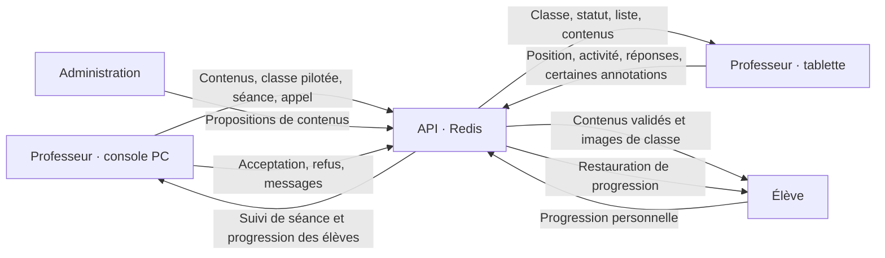

# Analyse professeur PC ↔ tablette ↔ cloud ↔ élève

Analyse du code local, réalisée le 5 septembre 2026. Aucun code applicatif modifié. Les constats de concurrence et de réseau ci-dessous proviennent de la lecture du code ; ils n'ont pas été reproduits avec deux appareils physiques ni avec le service Redis de production.

## 1. Organisation actuelle

Le professeur possède un seul rôle serveur, présenté sous deux interfaces. Le mode PC sert à préparer et gérer ; la tablette sert à consulter, expliquer, annoter et animer. Le cloud relie leurs données, sans recopier intégralement leurs écrans. L'élève possède une progression personnelle et reçoit les contenus de son professeur associé.

### Accès et choix de l'interface

- Le rôle professeur doit être confirmé par la session serveur ; un rôle enregistré localement ne suffit pas. Le serveur revérifie les droits et les niveaux autorisés.
- En mode automatique, un PC est reconnu par une largeur d'au moins 1024 px, un pointeur fin et l'absence de pointeur tactile. Un PC tactile ou une fenêtre étroite peut donc ouvrir l'interface tablette.
- Les préférences `auto`, `pc`, `tablet` permettent de forcer le choix. Elles sont locales à l'appareil. `?profSurface=tablet` ouvre une fenêtre pédagogique séparée sur le PC : ce n'est pas une connexion à une tablette physique.
- Le mode tablette conserve les privilèges professeur : ce n'est pas un passage au rôle élève.

Sources : `src/App.tsx:81`, `src/hooks/useMediaQuery.ts:115`, `src/hooks/useProfViewMode.ts`, `src/services/profViewModeService.ts`, `src/server/professor/shared.ts:271`.

### Fonctionnalités par surface

| Surface | Fonctionnalités effectivement reliées |
|---|---|
| Professeur PC | Choix du niveau, gestion et programmation de séance, historique et impression, appel, liste et rotation, consultation de progression, notifications, partage d'images, Studio d'édition et publication. |
| Professeur tablette | Dashboard pédagogique du niveau piloté, révision, quiz, exercices, aperçu des élèves avant lancement, consultation du suivi, outils manuscrits, animation du quiz, remontée d'activité. |
| Élève | Consultation des ressources, quiz et exercices personnels, progression sauvegardée, notifications et ouverture d'une image partagée par lien. |
| Administration | Attribution du rôle, autorisation d'appareils, rattachement élève–professeur, droits par niveau, publication officielle et propositions au professeur. |

La liste de rotation contient des entrées propres au jeu ; elle n'est pas identique au registre des comptes élèves. La participation orale et les réponses du quiz animé ne sont donc pas automatiquement des résultats individuels déposés dans la progression de chaque élève.

Sources : `src/components/ProfStudio/shell/profSections.ts`, `src/components/ProfStudio/session/useRotationController.ts`, `src/components/ProfStudio/ProfSessionGate.tsx`, `src/hooks/useProfessorQuizGame.ts`.

## 2. Échanges dans chaque sens

### PC → tablette → PC

Le PC publie une classe de travail via `session-focus`. Le dashboard tablette lit cette sélection. Une séance en cours ou en pause conserve sa propre classe, même si le PC prépare un autre niveau. La tablette transmet ensuite la position dans le quiz, l'exercice ou la révision ; le PC la consulte pour le suivi et l'archivage.

Ce pilotage de classe est lu dans le dashboard. Il ne constitue pas une commande générale qui ferait changer à distance toutes les pages pédagogiques déjà ouvertes.

La rotation affecte la question à l'élève selon `questionIndex modulo taille de la liste`. Le serveur sépare la liste, l'état du jeu et les réponses ; les opérations de liste et de jeu utilisent des scripts Redis atomiques et des versions.

Sources : `src/components/Views/DashboardView.tsx:125`, `src/components/Views/DashboardView.tsx:340`, `src/hooks/useSessionActivitySync.ts`, `src/server/professor/classroomActions.ts:218`.

### Professeur → cloud → élève

Le Studio publie dans l'espace privé du professeur. L'élève est rattaché par `profId` et reçoit les remplacements de contenu autorisés pour son niveau. Pour les comptes disposant du gel des contenus officiels, les nouveautés officielles passent par des propositions à appliquer : elles ne remplacent pas automatiquement les choix du professeur.

Le partage d'image cible un élève pour la notification, mais l'image est lisible par toute sa classe. Cette portée collective est explicitement annoncée dans la fenêtre de partage ; ce n'est pas un envoi privé.

Sources : `api/content.ts:169`, `src/server/content/sync.ts`, `src/server/professor/sharing.ts:67`, `src/components/ProfStudio/session/ShareImageModal.tsx:60`.

### Élève → cloud → professeur

La progression est enregistrée localement puis envoyée à `/api/progress`. Le chargement cloud fusionne la progression avec le local, notamment par maxima et unions. Le PC lit les résultats des comptes encore associés au professeur et au niveau consulté.

Ce flux remonte des résultats, pas la vidéo de l'écran ni chaque geste de l'élève. Aucun envoi d'image initié par un élève n'a été trouvé dans les parcours inspectés : `shared-save` exige une session professeur.

Sources : `src/services/cloudSyncService.ts`, `api/professor.ts:64`, `src/server/professor/access.ts:99`, `api/professor.ts:155`.

### Cadences observées

Les délais indiqués sont des cadences nominales, auxquelles s'ajoutent réseau et traitement. Plusieurs boucles se cumulent.

| Circuit | Cadence |
|---|---|
| Classe pilotée, lue par le dashboard tablette | 1,5 s ; 1,2 s en mode rapide |
| Séance, lue côté PC | 4 s ; 1,2 s en mode rapide |
| Activité pédagogique envoyée par le professeur | 4 s, si le contenu change |
| Quiz animé | État toutes les 5 s ; liste complète environ toutes les 30 s |
| Publication de contenus | Vérification toutes les 5 s pour le professeur, 15 s pour l'élève |
| Progression élève | Envoi différé de 15 s, événements importants, secours périodique de 3 min |
| Progression des élèves relue par la console | 20 s |
| Liste de rotation / annotations du moteur dédié | Écriture différée de 650 ms / 750 ms |

La « synchronisation rapide » accélère certaines lectures Redis. Elle n'installe aucun transport local entre appareils, ne vérifie pas qu'ils utilisent le même WiFi et n'accélère pas toutes les boucles. La projection vidéo reste une action externe avec scrcpy, distincte des échanges de données.

Sources : `src/utils/syncPrefs.ts`, `src/components/ProfStudio/session/useClassroomSession.ts`, `src/components/ProfStudio/session/ProjectionSection.tsx`.

## 3. Anomalies et risques identifiés

### Priorité haute — concurrence sur l'état de séance

`session-set` et `session-activity` lisent puis réécrivent tout le même objet Redis, sans version conditionnelle ni fusion atomique commune.

Scénario : une activité tablette lit une séance `running` ; le PC enregistre ensuite `paused` ; l'activité réécrit son ancienne copie contenant `running`. La pause peut être annulée. Dans l'autre ordre, une commande du PC peut perdre la dernière activité. L'archivage peut également manquer les dernières informations.

Correction proposée : mises à jour atomiques des champs, contrôle de version et identifiant unique de séance pour rejeter les événements d'une ancienne séance.

Sources : `src/server/professor/sessionActions.ts:141`, `src/server/professor/sessionActions.ts:201`, `src/server/professor/sessionActions.ts:288`, `src/server/professor/sessionActions.ts:307`.

### Priorité haute — sauvegarde de liste écrasant une modification plus récente

Pendant une sauvegarde réseau, une deuxième modification met à jour `rosterRef`. Lorsque la première réponse arrive, `rosterRef.current = saved` remplace cette modification par l'ancien instantané. La sauvegarde suivante peut alors renvoyer cet ancien état.

Quitter la section avant les 650 ms annule aussi le minuteur sans envoi final dans ce hook.

Correction proposée : conserver séparément le brouillon courant et la version acquittée ; protéger ou terminer la sauvegarde à la sortie.

Source : `src/components/ProfStudio/session/useRotationController.ts:34` et `:46`.

### Priorité haute — fusion des annotations incompatible avec les effacements

Le moteur fusionne les identifiants par union. Un trait effacé sur un appareil mais présent sur l'autre peut donc réapparaître. Si le cloud contient un dessin vide, le code renvoie le dessin local sans vérifier que le vide correspond à un effacement plus récent. De plus, une fusion de même longueur que le dessin local n'est pas appliquée, même si ses propriétés ont changé.

Correction proposée : conserver les suppressions avec leur version, comparer le contenu et traiter les modifications d'un même trait. La règle serveur de dernière écriture ne suffit pas à rendre cette fusion client cohérente.

Source : `src/components/Revision/annotation/useAnnotationEngine.ts:14`, `:83`, `:88`.

### Priorité haute — annotations locales non isolées par compte

Le cache `mathplus:annotations:v2` et la file d'envoi du service canvas ne portent pas l'identité du compte. La déconnexion efface la progression mais pas ce cache ni cette file. Un second professeur ouvrant la même zone sur ce navigateur peut retrouver les marques du précédent ; une nouvelle sauvegarde ou une relance en attente peut les envoyer sous la session courante.

Correction proposée : clés locales et files rattachées à `accountId`, invalidation des opérations au changement d'identité, comme dans `cloudSyncService`.

Sources : `src/utils/annotationsStore.ts:23`, `src/services/teacherCanvasSyncService.ts:4`, `src/components/MediaRenderer.tsx:255`, `src/hooks/useGlobalProgress.ts:277`, `src/services/storageService.ts:259`.

### Priorité moyenne — activité perdue après un échec réseau

L'empreinte `lastRef` est enregistrée avant l'acquittement réseau. Si l'envoi échoue et que l'activité ne change plus, les cycles suivants la considèrent déjà envoyée et ne réessaient pas. Le démontage ne transmet pas non plus la dernière activité.

Correction proposée : distinguer activité en attente et activité acquittée, relancer après échec, effectuer un dernier envoi adapté au cycle de vie de la page.

Source : `src/hooks/useSessionActivitySync.ts:28`.

### Priorité moyenne — panne du manifeste interprétée comme retrait des contenus

Une erreur HTTP ou réseau produit `{}`. La boucle accepte cet objet comme un nouveau manifeste valide, efface les remplacements connus et déclenche leur invalidation. Une panne peut donc entraîner un retour au contenu statique, voire rendre un contenu créé uniquement dans le cloud indisponible.

Correction proposée : distinguer échec de lecture et manifeste réellement vide ; conserver la dernière version connue pour le même compte et le même périmètre.

Source : `src/services/contentOverrides.ts:50`, `:97`, `:102`.

### Priorité moyenne — rafraîchissement filtré sur la classe du compte

`App` filtre les publications selon `user.classId`, alors que la tablette peut consulter une autre classe pilotée. Une publication limitée à cette autre classe peut donc être ignorée par le rafraîchissement du dashboard. Les vues pédagogiques déjà ouvertes n'ont pas non plus de rafraîchissement uniforme relié à `contentRevision`.

Correction proposée : invalider les chemins concernés indépendamment de la classe principale, puis rafraîchir selon la classe et la ressource effectivement affichées ; prévoir une reprise sûre pour un quiz déjà commencé.

Sources : `src/App.tsx:239`, `src/components/Views/DashboardView.tsx:125`.

## 4. Limites fonctionnelles à distinguer des bugs

- Plusieurs systèmes manuscrits coexistent : le moteur `BoxNoteZone` sauvegarde et recharge un document cloud ; les zones `InlineCanvasZone` stockent leurs traits localement et peuvent alimenter la séance ; le tableau d'exercice utilise encore un stockage séparé. Il n'existe pas une synchronisation uniforme de tous les dessins.
- Une révision transmet ici sa section courante, pas un instantané de toutes ses annotations. Une archive de séance n'est donc pas une copie complète de la tablette.
- Une tablette déjà authentifiée peut conserver ses droits en mémoire pendant une panne réseau, mais un démarrage à froid sans validation serveur ne réactive pas le rôle professeur depuis le seul cache local.
- Le lecteur élève d'images est branché sur `?shared=...` dans `App`. Aucune galerie élève générale appelant `listStudentSharedImages` n'a été trouvée ailleurs : la disponibilité via API ne garantit pas une navigation de rattrapage visible pour toute la classe.
- Les indicateurs « synchronisé » sont propres à certains circuits. Ils ne garantissent pas simultanément la sauvegarde des contenus, présences, dessins et activités.

## 5. Vérification effectuée et suites proposées

`npm run type-check` : réussi.

Tests ciblés existants : **14 fichiers, 92 tests réussis**, couvrant API professeur, classes, droits, séances, contenu et propositions, progression, services de publication et de classe, archives et routage. Leur premier lancement a échoué sur une restriction locale de lecture d'esbuild ; le lancement autorisé hors de cette restriction a réussi.

Ces résultats ne valident pas les scénarios de concurrence décrits ci-dessus. Les prochains essais utiles sont : pause PC pendant un envoi tablette, modification de liste pendant une réponse lente, effacement d'annotations entre deux appareils, changement de compte sur un même navigateur, panne du manifeste et publication dans une classe pilotée différente de la classe principale.

Ordre de correction proposé : concurrence et isolation des données ; acquittements et reprise réseau ; rafraîchissement multi-classe ; unification des annotations et clarification des indicateurs de synchronisation.
