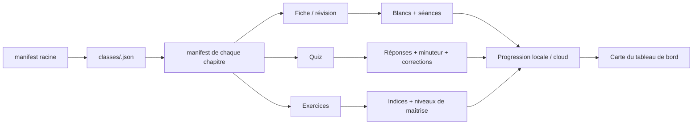

# Audit technique complet — Math en tête

Date d'analyse : 13 juillet 2026  
Périmètre : cartes du tableau de bord, JSON pédagogiques, mécanismes de progression, navigation, persistance, PWA et API Vercel.

## Verdict

L'application a une architecture front-end cohérente et une bonne séparation entre vues, services, hooks et contenu. Le socle TypeScript est sain (`type-check` et ESLint passent). En revanche, plusieurs défauts empêchent ou dégradent des parcours réels : session d'exercices non bornée à la classe, olympiades 1BAC inaccessibles, références JSON cassées, score de « maîtrise » trop permissif, et API de données personnelles non authentifiée.

Priorité immédiate : corriger les parcours cassés, puis introduire une véritable authentification côté API avant tout déploiement public.

## 1. Cartographie fonctionnelle

```mermaid
flowchart TD
  A[App.tsx] --> B[useGlobalProgress]
  A --> C[useAppNavigation]
  C --> D[DashboardView]
  D --> E[ChapterCard]
  E --> F[Leçon]
  E --> G[Quiz]
  E --> H[Exercices]
  F --> I[RevisionView + useRevisionSheet]
  G --> J[QuizSessionView + useQuizLogic]
  H --> K[ExerciseSessionView + useExerciseData]
  B --> L[storageService]
  B --> M[cloudSyncService]
  M --> N[/api/progress + Redis]
  D --> O[Examens / Problèmes / Olympiades / Concours]
```

Le routage est un routeur interne par état (`AppView`), pas React Router. Les vues sont chargées à la demande. Le contenu de cours, exercices et quiz reste dans `public/data`, donc modifiable sans recompilation du code applicatif.

### Cartes de chapitre

Une carte est construite à partir de :

| Donnée | Source | Effet sur la carte |
|---|---|---|
| Leçon | `revisions` du manifeste de chapitre | étape « Leçon » et son pourcentage |
| Quiz | fichier `quiz/*.json` + état sauvegardé | étape « Quiz », score et verrouillage |
| Exercices | `exercises/*.json` + `exerciseFeedback` | étape « Exercices » et pourcentage |
| Progression | `useGlobalProgress` | état courant, badge, chapitre actif |

Les seuils sont centralisés dans `src/utils/chapterProgress.ts` : quiz après 10 % de leçon, exercices après 15 % de quiz ou soumission du quiz.

## 2. Inventaire JSON

Tous les **908 JSON** sont syntaxiquement valides.

| Ensemble | Fichiers | Données vérifiées |
|---|---:|---|
| Classes | 8 | 64 chapitres actifs (3 classes collège actuellement vides) |
| Manifeste de chapitre | 74 | 64 atteignables par le manifeste racine |
| Fiches de révision | 124 | 808 sections, 2 412 blocs |
| Quiz | 77 | 1 038 questions |
| Exercices | 471 | 1 694 questions, 1 305 sous-questions |
| Examens nationaux | 24 | chargés par un service dédié |
| DS | 21 | données présentes, pas de module dashboard dédié identifié |
| Olympiades | 26 | accès direct par le module Olympiades |
| Concours | 36 | accès direct par le module Concours |

Le parcours scolaire décrit par les manifests actifs contient 433 exercices, 65 fichiers de quiz et 53 références de fiches. Les fichiers supplémentaires ne sont pas automatiquement du code mort : les examens, problèmes, olympiades et concours ont leur propre point d'entrée. Toutefois, les manifestes suivants ne sont pas référencés par leur classe :

- `data/2eme-bac-sc-ex/etude-fonctions/manifest.json`
- `data/2eme-bac-sc-math/espaces-vectoriels-reels/manifest.json`
- `data/2eme-bac-sc-math/groupe-anneau-corps/manifest.json`
- `data/2eme-bac-sc-math/lois-composition-interne/manifest.json`

Leur contenu n'apparaît donc pas sur les cartes du parcours principal.

## 3. Défauts confirmés

| Priorité | Constat | Impact | Preuve / source |
|---|---|---|---|
| P0 | La session normale ne reçoit pas `classId`. Elle lit ensuite une ancienne clé `planet-math:app:v6.0`, alors que l'état actuel est stocké dans `planet-math:app-core:v6.0`. | Tous les exercices de toutes les classes sont chargés ; un chapitre de même identifiant dans deux classes peut être mélangé. Coût réseau et mémoire inutilement élevé. | `src/App.tsx:131`, `src/components/Views/ExerciseSessionView.tsx:84-115`, `src/hooks/useExerciseData.ts:67-73` |
| P0 | Les API de progression acceptent lecture et écriture avec seulement `phone` + `classId`, sans session ni jeton utilisateur. | Toute personne connaissant ces deux valeurs peut lire ou altérer une progression. | `api/progress.ts:76-120` |
| P0 | La connexion est fondée uniquement sur un numéro de téléphone, sans OTP ni mot de passe ; la modification de profil est aussi non authentifiée. | Usurpation de compte et modification/migration de profil ou de progression possibles. | `api/users.ts:202-320`, `api/users.ts:323-370` |
| P1 | Le service Olympiades transforme `1ere-bac-sc-math` en `1er-bac-sc-math`, dossier inexistant. Les 12 sujets du manifeste pointent également vers ce mauvais chemin. | L'onglet Olympiades de 1BAC Math ne peut pas charger son manifeste, puis aucun sujet. | `src/services/olympiadService.ts:56-91`, `public/data/1ere-bac-sc-math/olympiad/manifest.json:29-150` |
| P1 | Une fiche de dénombrement est référencée mais absente. | La deuxième fiche du chapitre Probabilités / Dénombrement affiche « Document indisponible ». | `public/data/2eme-bac-sc-ex/probabilites/manifest.json:15` |
| P1 | Trois questions « error-spotting » n'exposent aucune étape avec `isError: true` ; deux utilisent `errorStepId`, ignoré par le parseur. | Il est impossible de répondre correctement à ces trois questions. | `src/services/quizService.ts`, `public/data/1ere-bac-sc-math/limites/quiz/limites_quiz.json`, `public/data/1ere-bac-sc-math/suites/quiz/suites_quiz.json` |
| P1 | Le hook de fiche ajoute les sections de méthodes directement dans l'objet mis en cache. | À chaque réouverture d'une même fiche, les sections méthodes peuvent être dupliquées. | `src/hooks/useRevisionSheet.ts:41` |
| P1 | Le statut « Maîtrisé » compte un exercice `skipped` comme un exercice terminé. Un quiz simplement soumis, même avec score faible, est aussi considéré terminé. | Une carte peut annoncer 100 % / « Maîtrisé » sans apprentissage démontré. | `src/components/Dashboard/ChapterCard/useChapterCard.ts:70-99`, `src/hooks/useDashboardStats.ts:82-90` |
| P1 | Le déblocage permanent est sauvegardé sous une clé ne contenant que `chapterId`. | Deux profils ou deux classes partageant un même identifiant de chapitre peuvent se déverrouiller mutuellement. | `src/components/Dashboard/ChapterCard/useStickyUnlock.ts:33-47` |
| P1 | Le changement de classe renomme la progression de l'ancienne classe vers la nouvelle. | Une progression d'un programme peut être transplantée dans un autre au lieu d'être conservée et isolée. | `src/hooks/useGlobalProgress.ts:371-381`, `src/utils/progressScope.ts:7-21` |
| P1 | Le build de production s'arrête lors de la génération Workbox. | Aucune livraison locale complète n'est produite dans ce répertoire. | Chemin de travail contenant `it's me` : l'apostrophe casse l'import absolu généré pour `sw.js`. |
| P2 | Deux médias référencés n'existent pas. | Images manquantes dans les exercices concernés. | `1ere-bac-sc-math/ensembles-app/exercises/ex-ens-app-02.json` ; `2eme-bac-sc-ex/calcul-integral/exercises/ex_14.json` |
| P2 | Cinq références de DS sont absentes (3 en 1BAC Ex, 2 en TC). | Fonction DS indisponible ou incomplète si elle est exposée ultérieurement. | `public/data/1ere-bac-sc-ex/ds/index.json`, `public/data/tronc-commun-sc/ds/index.json` |
| P2 | `useExerciseData` conserve une progression de sous-questions dans une clé globale non scindée par utilisateur, tandis que l'interface utilise le feedback global des exercices. | Deux sources de vérité et du code de progression devenu inopérant dans la vue actuelle. | `src/hooks/useExerciseData.ts`, `src/components/Views/ExerciseSessionView.tsx:82` |

## 4. Logique de progression : comportement réel et écart métier

La progression des cartes est calculée indépendamment des statistiques globales :

- la carte compte le nombre de clés dans `exerciseFeedback` ;
- les statistiques globales pondèrent la maîtrise (`high=1`, `skipped=0`) mais utilisent aussi ce nombre de clés pour le taux de complétion ;
- la fiche augmente uniquement avec les blancs révélés et compétences cochées ; lire sans révéler de blanc ne progresse pas ;
- un quiz soumis est toujours affiché comme 100 %, quel que soit le score.

Cette logique mélange **achèvement**, **participation** et **maîtrise**. Il faut choisir trois indicateurs explicitement séparés :

1. `completion` : activité terminée ;
2. `mastery` : score / réussite réelle ;
3. `unlock` : droit d'accès, persistant et borné au profil et à la classe.

La carte peut alors afficher « terminé » sans affirmer « maîtrisé ».

## 5. Validation et chargement du contenu

`contentService` valide aujourd'hui seulement l'existence de `id` et `questions` pour un exercice, et `header` / `sections` pour une fiche. Il ne valide pas :

- l'unicité des identifiants ;
- les types de blocs, questions et réponses ;
- les références de fichiers ou médias ;
- les champs nécessaires à chaque type de quiz ;
- la compatibilité entre manifeste de classe, manifeste de chapitre et fichier final.

Une validation CI unique, exécutée avant le build, doit parcourir tous les JSON et échouer à la première référence ou structure incompatible. Elle aurait détecté la fiche absente, les olympiades et les trois quiz impossibles.

## 6. Résultats des contrôles

| Contrôle | Résultat |
|---|---|
| `npm run type-check` | réussi |
| `npm run lint` | réussi |
| Parse de 908 JSON | réussi, 0 erreur de syntaxe |
| Références `path` | 30 absentes : 12 olympiades, 12 doublons dans un index olympiades secondaire, 5 DS, 1 fiche |
| Références médias | 2 absentes |
| `npm run build` | échec Workbox après transformation de 2 250 modules |

Le bundle applicatif est généré jusqu'à l'étape service worker ; l'échec provient du chemin Windows contenant une apostrophe, pas d'une erreur TypeScript dans l'application.

## 7. Plan de correction recommandé

1. **Réparer les parcours visibles** : transmettre `user.classId` à la session d'exercices, supprimer le repli vers la clé obsolète, réparer les chemins Olympiades, la fiche manquante, les médias et les questions `error-spotting`.
2. **Protéger les données** : authentification avec session signée / JWT ou cookie HttpOnly, OTP pour la connexion téléphone, contrôle d'identité côté API pour `progress`, profil et concours.
3. **Unifier la progression** : une source de vérité, clés `{userId}:{classId}:{chapterId}`, indicateurs distincts pour terminer et maîtriser, et migration non destructive lors d'un changement de classe.
4. **Rendre le contenu fiable** : schémas Zod/JSON Schema, validateur de références et test de parcours en CI.
5. **Rendre le build reproductible** : construire depuis un chemin sans apostrophe, puis adapter/mettre à jour la configuration PWA ou Workbox si le build doit rester compatible avec ce type de chemin.

## 8. Conclusion

Le projet est riche, structuré et presque entièrement piloté par des données. Ses principaux risques ne proviennent pas du typage, mais de frontières insuffisamment contrôlées : entre classes, profils, fichiers JSON et API publiques. En corrigeant d'abord les quatre P0/P1 de parcours, puis l'authentification et la validation de contenu, l'application gagne rapidement en fiabilité pédagogique, en performance et en sécurité.

---

## Annexe — Référence fonctionnelle détaillée : ce que fait réellement l'application

Cette annexe complète l'audit par une lecture des parcours et du code exécuté. Elle distingue le **format de données prévu**, ce que l'interface **rend réellement**, et les écarts constatés.

### A. Parcours principal de l'élève



1. L'élève crée un profil ou se reconnecte avec son numéro de téléphone.
2. Le tableau de bord charge le manifeste de sa classe, puis les manifestes de chapitres et leurs exercices.
3. Chaque carte de chapitre propose, seulement si la donnée existe, les étapes **Leçon**, **Quiz**, **Exercices**.
4. Les résultats sont écrits localement, puis synchronisés au cloud lorsque le réseau est disponible.
5. Les autres onglets sont des parcours parallèles : examens, problèmes, olympiades et concours.

Le routage repose sur l'état interne de `App.tsx` et le hash d'URL, avec les vues : `login`, `dashboard`, `session`, `quiz`, `revision`, `concours-quiz`, `examen-session`, `ds-session`, `probleme-view`, `cadre-referentiel`. Il n'y a pas de routeur de type React Router.

### B. Carte de chapitre : modèle réel, règles et limites

| Étape | Source de contenu | Source de progression | Règle d'accès | Ce qui est considéré comme « terminé » |
|---|---|---|---|---|
| Leçon | `chapter.revisions[0]` | blancs révélés + compétences cochées | jamais verrouillée si présente | 100 % des blancs et compétences |
| Quiz | `chapter.quizzes[0]` | historique, score, soumission | après 10 % de leçon ; déblocage mémorisé | quiz soumis, quel que soit le score |
| Exercices | toutes les entrées `chapter.exercises` | un feedback par exercice | après 15 % de quiz ou quiz soumis ; déblocage mémorisé | chaque exercice a reçu un feedback, y compris `skipped` |

Les pourcentages de cartes ne représentent donc pas une évaluation académique stricte : ils représentent surtout l'avancement des activités. Le score de quiz reste affiché, et les statistiques globales calculent séparément une vraie pondération de feedback (`high=1`, `medium=0,6`, `low=0,3`, `skipped=0`), mais ce signal n'est pas celui qui décide le badge « Maîtrisé » de la carte.

Le déblocage est volontairement permanent : une étape ouverte ne se reverrouille pas après une remise à zéro. C'est cohérent pour l'expérience élève, mais sa clé actuelle (`mathplus:sticky-unlock:<chapterId>`) doit contenir au minimum le profil et la classe.

**Écart confirmé : plusieurs fiches ou quiz dans un même manifeste ne sont pas pris en charge par l'interface principale.** `ChapterStepList.tsx:64-66` ouvre uniquement `revisions[0]` et `useQuizLogic.ts:147` charge uniquement `quizzes[0]`. Le manifeste `2eme-bac-sc-ex/probabilites/manifest.json` contient deux fiches et deux quiz ; la fiche et le quiz de dénombrement sont actuellement inatteignables depuis la carte. La fiche manquante signalée dans l'audit est donc aussi une référence non exposée dans l'état actuel de l'interface.

### C. Contrats JSON et rendu des exercices

Le contrat effectivement consommé est :

```json
{
  "id": "exemple-01",
  "chapterId": "identifiant-du-chapitre",
  "topic": "optionnel",
  "context": "énoncé commun optionnel",
  "sessionDate": "date ISO optionnelle",
  "requiresRedaction": false,
  "media": { "src": "/data/.../image.png", "position": "right" },
  "questions": [
    {
      "id": "q1",
      "type": "partie | question | text",
      "content": "Texte et LaTeX",
      "subQuestions": [
        {
          "id": "a",
          "content": "Question à traiter",
          "hint": "Indice optionnel",
          "correction": "Correction optionnelle",
          "bareme": 1,
          "media": { "src": "/data/.../schema.png" }
        }
      ]
    }
  ]
}
```

Le moteur `ExerciseEngine` normalise trois cas :

- `partie` ou `header` devient un intertitre ;
- `text` devient un bloc de texte ;
- une `question` sans `subQuestions` est convertie en une sous-question synthétique `main` afin d'unifier le rendu.

L'interface affiche le contexte, les questions numérotées, les points, l'image éventuelle et un indice repliable par sous-question. Elle ne vérifie pas une réponse mathématique : l'élève révèle l'indice au besoin, puis s'auto-évalue à la fin de **l'exercice entier**. « Valider » demande une durée optionnelle ; « Passer » enregistre `skipped`.

**Écart confirmé : la profondeur du format annoncé n'est pas rendue.** Le type TypeScript et le guide autorisent des sous-sous-questions, mais `parseSubQuestions` (`src/components/Exercise/engine/ExerciseEngine.ts:58-79`) ne parcourt qu'un niveau. Sept sous-sous-questions existantes sont donc invisibles :

- `public/data/1ere-bac-sc-math/ensembles-app/exercises/ex-ens-app-12.json` : 2 éléments ;
- `public/data/1ere-bac-sc-math/produit-scalaire/exercises/ex-geo-20.json` : 5 éléments.

Les examens, DS et olympiades conservent eux aussi ce champ récursif lors de leur conversion en exercice, mais perdent donc les mêmes niveaux imbriqués à l'affichage.

### D. Révision : fiches, blocs, mémoire active et compétences

Une fiche de révision suit ce contrat :

```json
{
  "header": { "title": "…", "subtitle": "…", "context": "…" },
  "lexique": [
    { "term": "limite", "arabic": "نهاية", "definition": "…", "category": "concept" }
  ],
  "sections": [
    {
      "id": "section-1",
      "title": "Question pédagogique",
      "category": "course | method | domain | subdomain",
      "blocks": [
        { "type": "definition", "title": "…", "content": "…" },
        { "type": "application", "difficulty": 3, "content": "…" }
      ]
    }
  ]
}
```

Les blocs effectivement reconnus par le rendu couvrent notamment : `intro`, `text`, `definition`, `theorem`, `property`, `method`, `technique`, `strategy`, `warning`, `remark`, `application`, `example`, `exploration`, `proof`, `intuition`, `summary`, `problem`, `hint` et `solution`. Le rendu applique une sémantique et un style propres à chaque type ; plusieurs blocs théoriques sont volontairement repliés afin que l'élève formule sa réponse avant révélation.

Les fiches utilisent KaTeX et un parseur de macros. Les blancs `\blank{...}` deviennent cliquables, sont mémorisés par chapitre, et représentent une part de la progression. Un terme du lexique peut être surligné puis temporairement révélé en arabe ; un double-clic sur un mot peut aussi créer une annotation locale. Le panneau de sommaire fournit une navigation directe et une recherche parmi les sections.

La progression de révision suit exactement cette formule :

```text
blancs révélés ÷ nombre total de blancs
```

Elle ne mesure ni le temps de lecture ni l'ouverture des blocs. Un élève qui lit sans révéler de blanc ne fait donc pas progresser la carte.

### E. Quiz : variantes, chronométrage et reprise

Le parseur accepte les types suivants :

| Type JSON | Rendu et validation |
|---|---|
| `mcq` | choix unique ; chaque option porte `is_correct` ou `isCorrect` |
| `boolean` / alias `true-false` | réponse vrai/faux |
| `order` / alias `ordering` | déplacement vertical des éléments ; comparaison de l'ordre d'identifiants |
| `error` / alias `error-spotting` | sélection d'une étape dont `isError` doit être vrai |
| `input` | validation textuelle possible dans le service, mais aucun champ de saisie n'est rendu par `QuizCore` |

La séance standard applique un temps par question (JSON, réglage utilisateur ou défaut), suspend le décompte si l'onglet est caché, mémorise la réponse en cours et le temps restant, puis restaure cette question au retour. Après soumission, elle propose la relecture et le retravail des erreurs. Les réponses sautées ne créent aucun résultat ; elles comptent donc implicitement comme fausses à la soumission, car le score est calculé sur le nombre total de questions.

Le score n'est écrit qu'à la première soumission. « Refaire » remet l'état du quiz à zéro avant une nouvelle session ; « retravailler les erreurs » est une session d'entraînement locale qui ne doit pas augmenter le record principal.

Le contrat `input` est actuellement incomplet : `quizService.verifyAnswer` sait comparer `correctAnswers`, mais `QuizOptions` ne crée pas de contrôle de saisie. Aucun quiz actif n'emploie ce type, donc ce défaut est latent mais doit être corrigé avant d'ajouter ce format.

### F. Parcours spécialisés

| Parcours | Disponibilité | Mécanisme réel | Persistance |
|---|---|---|---|
| Examens nationaux | uniquement les deux classes 2BAC | annale complète, sujet par thème ou simulation aléatoire ; conversion en exercices affichés verticalement | feedback par exercice, sous un identifiant d'examen ou de session générée |
| Cadre référentiel | depuis le module Examens | fiche de révision dédiée `cadre_referentiel.json` | compétences enregistrées sous le chapitre artificiel `cadre_referentiel` |
| Problèmes | TC, 1BAC Math, 2BAC Math | index de problèmes ; chaque problème est rendu avec `RevisionView` en variante épurée | progression passée en no-op : pas de suivi persistant effectif |
| Olympiades | TC et 1BAC Math en théorie | manifeste puis conversion d'une épreuve en `DsDevoirData`, ensuite en exercices | feedback par épreuve ; 1BAC Math cassé par le chemin erroné signalé plus haut |
| DS | fichiers et convertisseur présents | pas de catalogue / onglet DS direct identifié ; actuellement surtout réutilisé par les olympiades | non exposé comme parcours autonome |
| Concours | classes 2BAC | catalogue d'écoles, annale, thème ou simulation échantillonnée par thème ; options mélangées | historique distinct `mathplus_concours_progress`, meilleur score et thème le plus faible |

La durée déclarée dans un examen, DS ou olympiade reste une métadonnée : la session verticale d'exercices n'impose pas de minuteur global ni de remise automatique à la fin du temps. Le minuteur visible sur un exercice normal est lié à `sessionDate` (créneau de correction), pas à la durée d'une épreuve.

La simulation d'examen choisit des exercices par thème selon `themeDistribution`, privilégie la difficulté demandée et cherche à varier les sources. Elle peut toutefois retourner moins d'exercices que la répartition annoncée si le contenu disponible d'un thème est insuffisant ; il n'y a pas de contrôle final de complétude. Le concours, à l'inverse, mélange les options et utilise un échantillonnage stratifié pour distribuer les thèmes dans une simulation.

### G. Stockage, synchronisation et vie du compte

| Donnée | Emplacement local | Synchronisation |
|---|---|---|
| Profil, XP, session | `planet-math:app-core:v6.0` | progression cloud au login et lors des sauvegardes |
| Quiz | tranche `planet-math:progress-quiz:v6.0` | fusion cloud par meilleur état |
| Exercices | tranche `planet-math:progress-exercises:v6.0` | union / préférence locale selon le champ |
| Révision | tranche `planet-math:progress-revision:v6.0` | maximum et union des blancs / compétences |
| Quiz en cours | clé locale par classe et chapitre | local uniquement pour la reprise immédiate |
| Concours | `mathplus_concours_progress` | envoi séparé best-effort vers `/api/progress?action=concours` |
| Temps global | clé par `uniqueId` ou nom | pas de synchronisation explicite de cette mesure dans le modèle principal |
| Notifications in-app | `mathplus:notifications:v3` | local uniquement |

La progression est scindée par classe avec des clés préfixées, puis présentée à l'interface sans le préfixe de la classe courante. La fusion cloud privilégie le maximum ou l'union : score le plus haut, plus grand nombre de tentatives, plus longue liste d'historique, union de blancs et compétences. Cette stratégie évite généralement une perte de progrès, mais elle ne représente pas toujours une chronologie cohérente d'un quiz.

Les sauvegardes locales sont différées pendant l'usage, forcées lors d'un changement de visibilité ou de fermeture, et le cloud est relancé après retour réseau. Le changement de classe doit être corrigé pour conserver deux espaces séparés au lieu de déplacer les données de l'ancien vers le nouveau programme. La déconnexion efface les tranches applicatives mais laisse les clés auxiliaires du téléphone, de la classe et du nom : cela mérite un nettoyage complet.

### H. Notifications, PWA et administration

Le système de notifications in-app génère localement des conseils, alertes de séances, rappels de calendrier, détection de nouveau contenu et rappels de révision inspirés d'Ebbinghaus. Il conserve au plus 80 notifications, cinq actives, et déduplique les événements. Les notifications push utilisent une souscription VAPID, réparée au login ou au retour en ligne ; le serveur peut cibler une classe ou un élève.

L'espace `public/admin` permet à un administrateur authentifié par secret de :

- lister, filtrer et supprimer des élèves ;
- consulter leur synthèse, leur progression détaillée et leurs résultats concours ;
- envoyer une notification immédiate, programmée ou liée à une séance ;
- gérer le calendrier de séances et consulter l'historique d'envoi.

Ces fonctions sont séparées du front élève. Les actions administratives vérifient un secret côté serveur, tandis que les routes élève de profil et de progression restent insuffisamment protégées, comme détaillé dans les P0.

La PWA met en cache le contenu via Cache API et une couche mémoire ; le service worker n'est pas construit dans le chemin de travail actuel à cause de Workbox. Hors build réussi, l'expérience hors ligne ne peut donc pas être considérée comme validée de bout en bout.

### I. Couverture actuelle par classe

| Classe | Parcours principal | Modules supplémentaires réellement proposés |
|---|---|---|
| Tronc commun scientifique | chapitres, leçons, quiz, exercices | problèmes, olympiades |
| 1BAC Sciences expérimentales | chapitres, quiz, exercices | aucun module spécial ; aucune fiche de révision active dans l'inventaire |
| 1BAC Sciences mathématiques | chapitres, leçons, quiz, exercices | problèmes, olympiades (cassées actuellement) |
| 2BAC Sciences expérimentales | chapitres, leçons, quiz, exercices | examens, concours |
| 2BAC Sciences mathématiques | chapitres, leçons, quiz, exercices | examens, problèmes, concours |
| 1re / 2e / 3e année collège | classes sélectionnables | aucun chapitre actif, donc tableau de bord vide |

### J. Décisions de conception à prendre

Pour transformer ces mécanismes en produit fiable, il faut fixer explicitement les décisions suivantes :

1. Une carte doit-elle mesurer l'achèvement, la maîtrise, ou les deux avec deux badges distincts ?
2. Une fiche de méthodes doit-elle être un cours affiché, une grille de compétences, ou les deux ?
3. Un manifeste peut-il contenir plusieurs fiches et quiz ? Si oui, l'interface doit les lister et la progression doit être identifiée par ressource, pas seulement par chapitre.
4. Les examens et DS sont-ils chronométrés et notés ? Si oui, il faut relier `duration`, barème, minuteur global et état de soumission.
5. Les problèmes et concours doivent-ils contribuer au tableau de bord général ? Aujourd'hui ils ont une persistance séparée ou inexistante.
6. Les structures imbriquées et réponses saisies doivent-elles être des fonctionnalités supportées ? Elles sont documentées ou typées, mais non pleinement exécutées.

Cette carte fonctionnelle permet désormais de relier chaque fichier JSON à son écran, chaque activité à sa persistance, et chaque règle pédagogique à son effet réel sur la progression.
