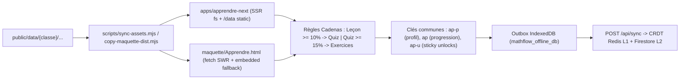

# Livret d’Architecture Transversal — MathFlow Apprendre (`maquette/` & `apps/apprendre-next/`)

> Ce livret complète [apps/apprendre-next/ARCHITECTURE_LIVRET.md](../../apps/apprendre-next/ARCHITECTURE_LIVRET.md) et sert de carte maîtresse pour la documentation technique sous `maquette/docs/`. Il doit être maintenu à jour à chaque modification structurelle.

---

## 1. Cartographie des Deux Cibles `Apprendre`

| Cible | Point d’entrée | Contraintes clés | Script de vérification |
| :--- | :--- | :--- | :--- |
| **Next.js 15 Native TypeScript** | [apps/apprendre-next](../../apps/apprendre-next/ARCHITECTURE_LIVRET.md) | App Router SSR + Client React 19, zéro JS `vendor/`, strict TS + ESLint | `cd apps/apprendre-next && npm run verify` |
| **Maquette Autonome (`file://`)** | [maquette/Apprendre.html](../Apprendre.html) | Zéro bundler, compatible `file://`, **chaque fichier source `<= 380` lignes**, PWA `sw-apprendre.js` | `npm run verify` (racine) + check `<= 380` lignes |

---

## 2. Documents Compagnons (`maquette/docs/`)

- [WORKFLOW.md](./WORKFLOW.md) : cycle de vie de chargement synchrone (`Apprendre.html`), ordre CSS/JS et routage hash.
- [STATES_AND_NODES.md](./STATES_AND_NODES.md) : schéma d’état local (`ap-p`, `ap`, `ap-u`), seuils de déblocage (`10 %` / `15 %`) et nœuds de chapitres.
- [THREADS_AND_ENGINES.md](./THREADS_AND_ENGINES.md) : séparation des moteurs (`math-engine`, `tkz-tab`, `lecon-renderer`, `quiz-renderer`, `exercice-*`).
- [CLOUD_PWA_NEXTJS.md](./CLOUD_PWA_NEXTJS.md) : contrat d’API (`/api/auth`, `/api/sync`), Redis L1 + Firestore L2 et contrat de migration Next.js.
- [GUIDE_EVOLUTION_ET_MISE_A_JOUR.md](./GUIDE_EVOLUTION_ET_MISE_A_JOUR.md) : checklist d’ajout de chapitre, filière, bloc ou route.

---

## 3. Flux Unifié Données → Rendu → Persistance

---

## 4. Règle de Mise à Jour Obligatoire

À chaque évolution (nouvelle route Next.js, nouveau type de bloc de révision, changement de règle de cadenas, nouvel endpoint Cloud) :
1. Mettre à jour [apps/apprendre-next/ARCHITECTURE_LIVRET.md](../../apps/apprendre-next/ARCHITECTURE_LIVRET.md) et/ou le document ciblé dans `maquette/docs/`.
2. Vérifier la cohérence automatique via `npm run verify:arch` (dans `apps/apprendre-next/`) et les contrôles globaux (`npm run verify` à la racine).

---

## 5. Audit transversal — 16 novembre 2026

Le détail des constats, mesures et limites figure dans les sections 6 à 8 du [livret Next](../../apps/apprendre-next/ARCHITECTURE_LIVRET.md).

- Le backend partagé vérifie strictement les JWT Google/Firebase et renouvelle les JWKS lors des rotations. Les sujets Firebase sont isolés par projet et séparés des sujets Google ; la lecture des sessions reste compatible avec les comptes Google historiques.
- Les deux API auth (portail et Next) vérifient le secret avant mutation de compte. Le modèle `.env.example` utilise les variables réellement lues : `ACCOUNT_SESSION_SECRET` et `PROF_SESSION_SECRET`, et reste versionné ; les fichiers contenant les valeurs locales sont exclus de Git.
- La génération `resetAt` empêche qu’une ancienne progression soit réintroduite après réinitialisation, côté serveur et dans les deux clients Next/maquette, y compris les cadenas et données de reprise. Le client Next recharge son état mémoire au changement de compte et ne sauvegarde pas les échos serveur identiques. Son outbox compacte les mutations dans une transaction IndexedDB et attend son commit.
- Une panne de lecture/rehydratation Redis n’empêche plus le secours Firestore. Le traitement DLQ conserve les jobs quand Redis ne répond pas. La réplication des enveloppes de progression, y compris lors du rejeu DLQ, fusionne le document L2 et utilise une précondition `updateTime`/`exists=false` avec trois tentatives bornées afin de protéger les écritures concurrentes.
- Le chargeur d’annales de la maquette expose `questionsCount` à partir des questions réellement chargées ; une série vide reste exclue.
- La PWA Next possède une source dédiée `scripts/pwa-worker.js`, des caches bornés qui préservent ceux de la maquette/du portail, deux icônes 192/512, une invalidation par filière et un écran hors ligne explicite. Le rechargement et la navigation entre pages visitées ont été vérifiés dans Edge hors connexion. Ce résultat ne constitue pas une validation du worker distinct de la maquette.
- Lint et rendus du portail ont été retouchés : état dérivé des stores partagés, restauration des traits du tableau par page, ratio d’image associé à la source, navigation d’authentification stable et absence de copies d’état synchrones inutiles dans les effets.
- Les services cloud réels ne sont pas configurés dans l’environnement local audité. Les tests RSA/Redis/Firestore sont simulés ; connexion Google interactive, règles Firestore déployées et cohérence entre deux appareils restent à valider sur l’URL publique correcte.
- Les dépendances du portail passent à Vite 6.4.6 et Vitest 4.1.12 ; son audit npm est réduit de 26 à 8 avis, sans critique ni élevé. L’application Next est auditée séparément et conserve un avis faible KaTeX. Les avertissements restants sont décrits dans le livret Next.
- Comparaison avec le parent : les seuils communs restent 10 % de leçon et 15 % de quiz traité, et les exercices sans quiz sont directement accessibles (maquette et Next). Next mesure désormais la maîtrise d’une fiche à blancs avec la même fonction que le parent ; le scroll conserve la position de lecture. Le DOM de leçon est stabilisé pour préserver les blancs lors des mises à jour React. Le worker de maquette v7 ne nettoie plus les caches du portail ou de Next.

La configuration Vercel à la racine compile encore le portail Vite avec `dist/apprendre/`. L’application complète `apps/apprendre-next/` nécessite son propre projet Vercel Next.js ; le starter redondant `next-app/` a été supprimé. Huit modules devenus orphelins du portail ont également été supprimés après recoupement Knip/imports/tests. La prévisualisation professeur reste un point d’entrée déclaré. L’ancien domaine documenté renvoie `DEPLOYMENT_NOT_FOUND` et le dernier déploiement retrouvé dans GitHub est protégé par l’authentification Vercel.
