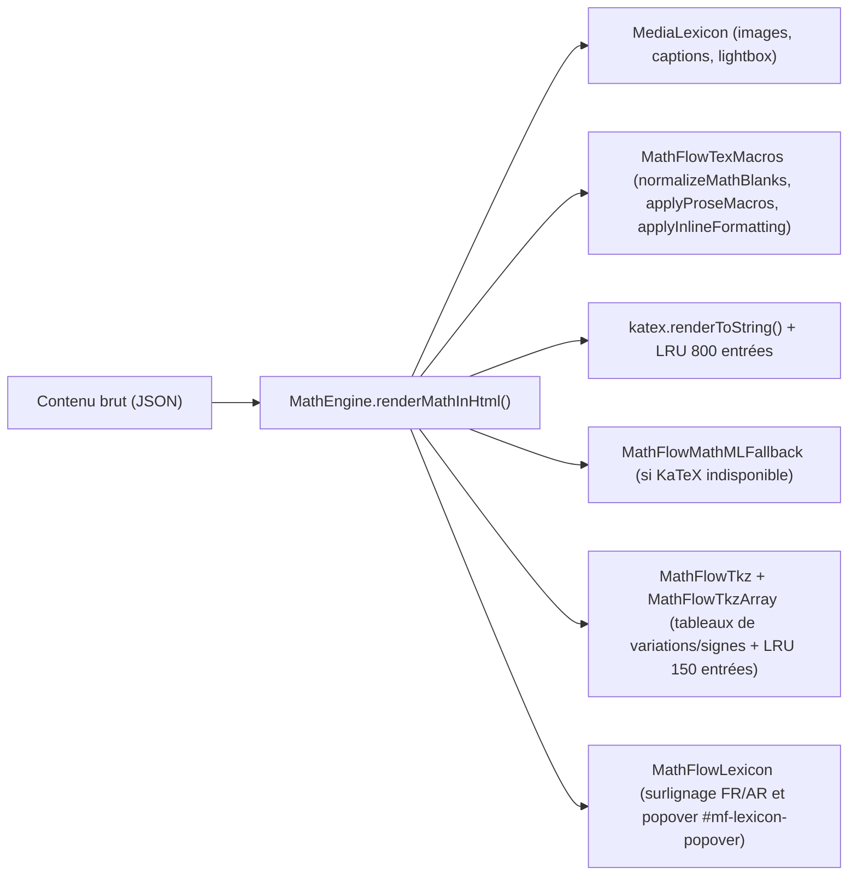

# THREADS AND ENGINES — Architecture modulaire des 4 couches

L’application est découpée en **4 couches fonctionnelles (« threads »)** indépendantes, chaque module restant sous **380 lignes** et exposant une API explicite sur `window` / `module.exports`.

---

## Couche 1 : Données & Persistance Hors-Ligne

| Module | Lignes max | Exports principaux | Responsabilité |
| :--- | :--- | :--- | :--- |
| `js/data/embedded-manifests.js` | ~47 | `MATHFLOW_DATA_PARTS.manifests` | Manifestes maître, classes, chapitres et index examens/problèmes/concours. |
| `js/data/embedded-revisions.js` | ~46 | `MATHFLOW_DATA_PARTS.revisions` | Fiches de révision, problèmes de synthèse et référentiels. |
| `js/data/embedded-practice.js` | ~252 | `MATHFLOW_DATA_PARTS.practice` | Séries d’exercices, quiz chapitres et annales du bac. |
| `js/data/embedded-concours.js` | ~48 | `MATHFLOW_DATA_PARTS.concours` | Quiz thématiques et annales ENSA / ENSAM / Médecine. |
| `js/data/lexiques.js` | ~195 | `MATHFLOW_DATA_PARTS` | Lexique bilingue FR/AR préchargé. |
| `js/content-data.js` | ~317 | `ContentService` (`getMasterManifest`, `getClassManifest`, `getChapterManifest`, `getRevisionSheet`, `getQuiz`, `getExercise`, `getExamensIndex`, `getExamen`, `getProblemesIndex`, `getProbleme`, `getConcoursIndex`, `getConcoursSchoolManifest`, `resolveMediaUrl`, `resolveMediaPaths`, `normalizePath`, `clearCache`, `EMBEDDED_DB`) | Routeur hybride réseau/CacheStorage/offline, normalisation des payloads et médias. |

---

## Couche 2 : Moteurs Mathématiques, TeX, Variations, Lexique & Médias

### Invariants critiques de `MathEngine.renderMathInHtml` (`maquette/js/math-engine.js`)
1. **Isolation des placeholders par invocation (`holdTag`)** : chaque appel génère `@@MF_HOLD_<TAG>_<IDX>@@` (`holdSeq` incrémental en base 36 majuscule). Ainsi, un appel récursif `renderSub(...)` (déclenché par `\method`, `\conclusion`, `\savant`, `\textbf`, etc.) ne détruit jamais les placeholders créés par l’appel parent.
2. **Ordre d’extraction obligatoire** :
   - Images `\image[opts]{src}{caption}` (`extractImages`)
   - Environnements `\begin{tikzpicture}...\end{tikzpicture}` (`parseTkzTab`)
   - Blocs mathématiques `$$...$$` et `\[...\]`
   - Maths en ligne `\(...\)` puis `$...$` (`extractInlineDollar`) **avant** `\begin{cases|array|...}` (évite qu’un environnement `cases`/`aligned` à l’intérieur d’une formule `$...$` soit extrait prématurément)
   - Environnements standalone `\begin{array|cases|pmatrix|...}` (`parseTkzTab` si tableau de variations)
   - Tableaux `\tkzTabInit...\tkzTab...` sans `tikzpicture` (`extractStandaloneTkz`)
   - Lignes mathématiques autonomes sans `$` dans les indices/corrigés (ex. `(x+1)^2 = 0 \iff x = -1`, filtrées par `bareMathRe` + `proseSkipRe` + zéro mot prose ≥ 4 lettres)
   - Blocs pédagogiques `\savant`, `\history`, `\objective`, `\motivation`, `\challenge`
   - Directives par ligne (`\step`, `\method`, `\conclusion`, `\tip`, `\attention`, etc.)
   - Macros prose (`applyProseMacros` : `\blank`, `\hl`, `\encadre`, `\mathqst`, listes `enumerate`/`itemize`, `\begin{columns}`)
   - Mise en forme inline Markdown (`**gras**`, `*italique*`, `^^souligné^^`, `==rouge==`, `++vert++`)
   - Restauration multi-passes de `@@MF_HOLD_<TAG>_<IDX>@@` puis surlignage lexical optionnel (`enableLexicon`).
3. **Macros TeX & tolérance auteur (`maquette/js/math/tex-macros.js`)** :
   - `normalizeMathBlanks` corrige `\blanck`/`\balck`/`[[...]]` et bascule `\textbf{...}` contenant des opérateurs/commandes mathématiques (`_`, `^`, `=`, `\`) vers `\boldsymbol{...}` afin d’éviter les erreurs KaTeX en mode texte.
   - `\mathqst{...}` dans `applyProseMacros` rend les formules pures (commençant par `\`) en KaTeX tout en préservant les étiquettes prose.

---

## Couche 3 : Shell, Minuteur, Audio & Modales

| Module | Exports principaux | Responsabilité |
| :--- | :--- | :--- |
| `js/app.js` | `MathFlowApp` (`DEFAULT_PROFILE`, `DEFAULT_STATE`, `TABS`, `getProfile`, `updateProfile`, `getState`, `saveState`, `resetProgress`, `getActiveClassId`, `getCachedClasses`, `getAvailableClasses`, `recordLastVisited`, `applyTheme`, `timer`, `playTone`, `formatTime`, `parseRoute`, `route`, `withViewTransition`, `escapeHtml`, `isSafeUrl`, `init`) | Point d’orchestration global : persistance `ap-p` / `ap` (`lastVisited` horodaté `at`), purge `ap-resume` sur reset, filières dynamiques, minuteur, WebAudio, routeur. |
| `js/core/resume-store.js` | `MathFlowResumeStore` (`readAll`, `clearAll`, `getLesson`, `saveLesson`, `hydrateQuizState`, `snapshotQuizState`, `hydrateExerciseState`, `snapshotExerciseState`, `syncExerciseDetails`, `handleExerciseSolToggle`) | Persistance fine de reprise d’étude `ap-resume` (position réelle de leçon + blancs, brouillons/timers de quiz, exercice actif + indices + corrigés `<details.sol>`) et repli intelligent depuis le cloud `ap`. |
| `js/core/ui-modals.js` | `MathFlowUiModals` (`init`, `openSettingsDialog`, `openExerciseCompleteDialog`, `openConfirmDialog`) | Hydratation du formulaire `#sf` (incluant `<select name="cls">` peuplé depuis `getAvailableClasses`), double confirmation de réinitialisation (`#rst`), notation fin d’exercice (`#dlg`). |

---

## Couche 4 : Contrôleurs & Moteurs de pages

### A. Hub Programme & Bibliothèques (`sidebar.js`, `programme-page.js`)
- `js/core/sidebar.js` (`MathFlowSidebar`) : rail latéral épuré avec **Orientation** puis **Paramètres** (`#av-side`) en haut, **Aide** en bas (sans bouton Accueil/Portail), et bascule mobile.
- `js/core/ui-modals.js` : gabarit modernisé pour la modale **Paramètres** (`#set`) structurée par cartes avec bouton de fermeture `×` et interrupteurs pillule.
- `js/pages/programme-page.js` (`ProgrammePage`) :
  - `mountLearn(container)` : charge `ContentService.getClassManifest(classId)` et ses chapitres en parallèle (`Promise.allSettled`), déplie automatiquement le dernier chapitre visité ou en cours, affiche la bannière ouverte sans cadre sur grille Seyès, les liens directs vers la dernière fiche/série active, le détail d’étape (« Question X / Y », « Exercice X / Y », section) et le marqueur `.is-last-step` (`Dernier arrêt`) sans zone supérieure ni mode Cartes.
  - `mountLibrary(container, tab)` : rend les onglets `#examens`, `#problemes`, `#prepa` avec filtrage interactif et indicateurs de reprise inline.

### B. Fiches de Révision & Problèmes de Synthèse (`#les`)
- `js/pages/lecon-search.js` (`LeconSearch`) : indexation plein texte normalisée (sans accents), extraits de recherche, `IntersectionObserver` scroll-spy pour `#toc` et persistance du défilement `S.l`.
- `js/pages/lecon-renderer.js` (`MathFlowLeconRenderer`) : génère la fiche, les titres héro `<h1 class="lt">` / `.kick` / `.sheet-tab` avec support LaTeX complet (`renderHeroTitleHtml`), les lettres de paragraphe **`A.`**, **`B.`**, **`C.`** (`.ltr` + `.lht` dans `#toc-sections` et `.lh`), les blocs compacts `details.blk`, et la pilule solution compacte alignée à droite `details.sol > summary`.
- `js/pages/lecon-page.js` (`LeconPage`) : chargement leçon/problème, normalisation des problèmes en fiche unique, pliage/dépliage global (`[data-fold]`), révélation des blancs (`.blank`, `[data-all]`), mode focus plein écran sur double-clic (`.blk`), recherche `#tqs` dans `#toc`.

### C. Quiz & Concours (`#quiz` — v2)
- `js/pages/quiz-loader.js` (`MathFlowQuizLoader`) : résout les quiz chapitres, quiz concours et annales.
- `js/pages/quiz-renderer.js` (`MathFlowQuizRenderer`) : normalisation tolérante (`toText`, `resolveCorrectIndex` avec repli drapeau/index/id/lettre/texte et garde `-1`, alias booléens, cache KaTeX LRU 500 entrées), comparaison sémantique `canonAnswer`/`sameAnswer` (`0,5`, `\frac{1}{2}`, `x = 0.5`), garde `isAnswerable`, surlignage `.opt.is-selected` / `[aria-pressed="true"]`, bloc comparatif `Attendu` / `Votre choix` dans `#quiz-feedback` et écran de synthèse avec révision des erreurs.
- `js/pages/quiz-page.js` (`QuizPage`) : boucle questions, alerte `st.notice` si validation à vide (sans noter faux), focus `#quiz-feedback`, compte à rebours tiers-temps, raccourcis clavier, persistance `S.q`.

### D. Exercices & Examens Nationaux (`#exo` — v2)
- `js/pages/exercice-parser.js` (`MathFlowExerciceParser`) : normalise les énoncés hiérarchiques (`Partie A`, `1.`, `a)`, `i.` jusqu’à 3999), tableaux de paragraphes (`toText`), repli `content: ""` → `statement`/`text`, barèmes (repli sur le parent si sous-questions sans barème), indices et corrigés.
- `js/pages/exercice-renderer.js` (`MathFlowExerciceRenderer`) : cache LRU KaTeX (600 entrées, `clearCache()`), échappement strict des attributs, carte d’indisponibilité + bouton `Réessayer` (`data-a="retry"`), pastilles accessibles (`role="group"`, `aria-current="true"`, état complet), ligne `.exo-row-head` avec bouton **Indice** ambre (`HINT_LAMP_SVG`), panneau `.exo-hint-panel`, corrigés `details.sol` et feuille d’examen A4.
- `js/pages/exercice-page.js` (`ExercicePage`) : jeton anti-course (`mountToken`), chargement borné (`POOL = 4`), conservation des index en cas d’échec, chronomètre monotone `#tm` anti-dérive avec temps suivi **par exercice**, écriture `S.e` uniquement sur modification (`dirty`), navigation clavier `←` / `→`, retour haut de page et gestion du focus.
