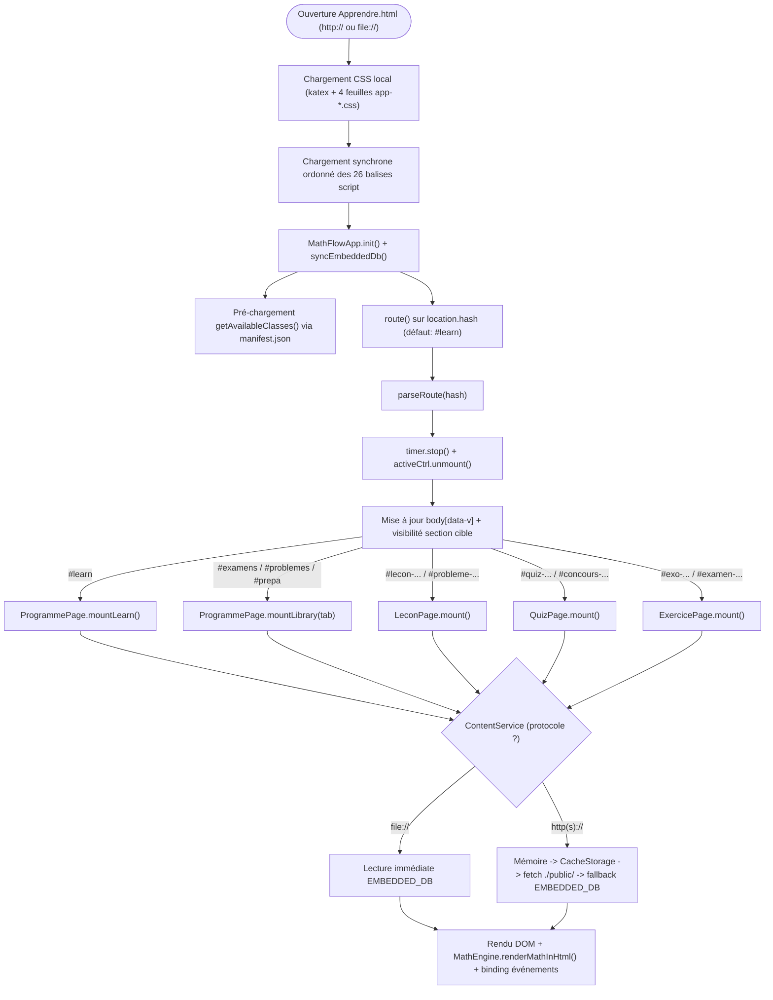
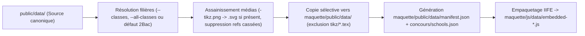

# WORKFLOW — Cycle de vie, Boot, Routage et Synchronisation

Ce document décrit le flux d’exécution complet de [`Apprendre.html`](../Apprendre.html), depuis le chargement des ressources jusqu’au rendu des vues et à la synchronisation des données.

---

## 1. Diagramme général du workflow applicatif

---

## 2. DAG de chargement déterministe (`Apprendre.html`)

Aucun bundler ESM n’est requis à l’exécution : chaque script s’attache au scope global (`window` / `globalThis`) en respectant l’ordre de dépendance strict déclaré à la fin de [`Apprendre.html`](../Apprendre.html) :

| Ordre | Fichier | Rôle dans la chaîne |
| :--- | :--- | :--- |
| **CSS 1** | `./vendor/katex/katex.min.css` | Feuille de styles mathématique KaTeX locale (hors-ligne). |
| **CSS 2** | `./css/app-tokens-base.css` | Palette `:root`, mode sombre `@media` / `[data-theme]`, typo `--doc-serif` / `--doc-scale`, shell, hub `#learn` & `#lib`. |
| **CSS 3** | `./css/app-views.css` | Mise en page révision `#les` (blocs `.blk[data-k]`, `.sol`, `#toc`), quiz `#quiz`, exercices `#exo` (`.exo-hint-btn`). |
| **CSS 4** | `./css/app-math-widgets.css` | Tableaux de variations `.tkz-tab`, directives `.math-command-line`, popover lexique, lightbox médias, `.math-mathqst`. |
| **CSS 5** | `./css/app-print.css` | Feuille d’impression A4 (`@media print` & mode d’examen imprimable). |
| **JS 1** | `./vendor/katex/katex.min.js` | Librairie KaTeX locale embarquée. |
| **JS 2–6** | `./js/data/embedded-*.js`, `lexiques.js` | Peuplent `window.MATHFLOW_DATA_PARTS` (`manifests`, `revisions`, `practice`, `concours`, `lexiques`). |
| **JS 7** | `./js/content-data.js` | Compile `EMBEDDED_DB` et expose `ContentService`. |
| **JS 8–14** | `./js/math/*.js` + `./js/math-engine.js` | Moteurs MathML, macros TeX, `tkz-tab`, `tkz-array`, lexique, médias puis façade unifiée `MathEngine`. |
| **JS 15** | `./js/core/ui-modals.js` | Gestion des `<dialog id="set">`, `#dlg` et `#mf-confirm-dialog`. |
| **JS 16–25** | `./js/pages/*.js` | Triplets autonomes (`lecon-*`, `quiz-*`, `exercice-*`) + `programme-page.js`. |
| **JS 26** | `./js/app.js` | Initialisation stockage (`ap-p` / `ap`), thème, timer, audio WebAudio et routeur SPA `#hash`. |

> [!IMPORTANT]
> Les polices Google Fonts dans `<head>` utilisent `media="print" onload="this.media='all'"` avec repli `<noscript>` et une pile système `--serif` / `--sans` dans `app-tokens-base.css` pour éviter tout blocage du premier rendu en mode hors-ligne.

---

## 3. Pipeline du routeur SPA (`MathFlowApp.parseRoute` & `route`)

Défini dans [`maquette/js/app.js`](../js/app.js) :

| Modèle d’ancre (`location.hash`) | `body[data-v]` | Contrôleur monté | Options extraites (`r.opts`) |
| :--- | :--- | :--- | :--- |
| `(vide)` ou `#learn` | `learn` | `ProgrammePage.mountLearn` | Programme de la filière active `P.cls` |
| `#examens` \| `#problemes` \| `#prepa` | `lib` | `ProgrammePage.mountLibrary(el, tab)` | `tab` (`examens` / `problemes` / `prepa`) |
| `#lecon-<chapterId>[?sheet=<id>]` | `les` | `LeconPage.mount` | `{ chapterId, sheetId, kind: 'lesson' }` |
| `#probleme-<problemeId>` | `les` | `LeconPage.mount` | `{ problemeId, kind: 'probleme' }` |
| `#quiz-<chapterId>[?quiz=<id>]` | `quiz` | `QuizPage.mount` | `{ chapterId, quizId, kind: 'chapter' }` |
| `#concours-<schoolId>[?annale=...&quiz=...]` | `quiz` | `QuizPage.mount` | `{ schoolId, annaleId, quizId, kind: 'concours' }` |
| `#exo-<chapterId>[?ex=<id>&mode=examen]` | `exo` | `ExercicePage.mount` | `{ chapterId, exerciseId, mode, kind: 'chapter' }` |
| `#examen-<examId>[?ex=<id>&mode=examen]` | `exo` | `ExercicePage.mount` | `{ examId, exerciseId, mode, kind: 'national' }` |

### Transitions et Cycle Montage/Démontage
1. À chaque changement de hash (`hashchange`), `withViewTransition(route)` déclenche `document.startViewTransition(route)` sauf si `P.reduceMotion === true`.
2. `route()` stoppe le chronomètre global (`timer.stop()`), appelle `activeCtrl.unmount()` (qui nettoie les écouteurs globaux, sauvegarde le scroll de leçon ou arrête les intervalles), bascule `body.dataset.v`, cache toutes les sections sauf `#${r.view}`, met à jour `aria-current="page"` dans `nav.tabs`, puis monte le nouveau contrôleur.

---

## 4. Workflow de résolution des données (`ContentService`)

Implémenté dans [`maquette/js/content-data.js`](../js/content-data.js) :

1. **Normalisation des chemins (`normalizePath`)** : supprime `?`/`#`, préfixes `../`, `./`, `maquette/public/`, `public/`, et garantit le préfixe canonique `data/...`.
2. **Détection du protocole** :
   - Sur **`file://`** : lecture synchrone depuis `EMBEDDED_DB` (aucune erreur CORS `fetch` ni requête réseau).
   - Sur **`http(s)://`** :
     - Étape A : `memoryCache` (`Map` en RAM) et déduplication `inFlight`.
     - Étape B : `CacheStorage` (`mathflow-student-content-v3`) avec revalidation réseau silencieuse (SWR) sur `./public/<normPath>`.
     - Étape C : si `fetch` échoue ou si la ressource est absente, fallback automatique sur `EMBEDDED_DB[normPath]`.
3. **Normalisation des charges (`normalizePayload`)** :
   - `resolveMediaPaths` réécrit tout champ `.src` relatif vers `./public/...` tout en bloquant `javascript:`, `vbscript:`, `file:`.
   - `syncSectionsAndBlocks` unifie `sections` / `chapters`, `blocks` / `items` et normalise les lexiques via `normalizeLexiconEntry`.

---

## 5. Pipeline de build & synchronisation (`scripts/sync-maquette-data.mjs`)

- Chaque JSON copié est validé par `sanitizeMediaNode` afin d’éviter les figures mortes dans la maquette autonome.
- Les 4 bundles embarqués générés sont :
  - `embedded-manifests.js` (`parts.manifests`)
  - `embedded-revisions.js` (`parts.revisions`)
  - `embedded-practice.js` (`parts.practice`)
  - `embedded-concours.js` (`parts.concours`)
